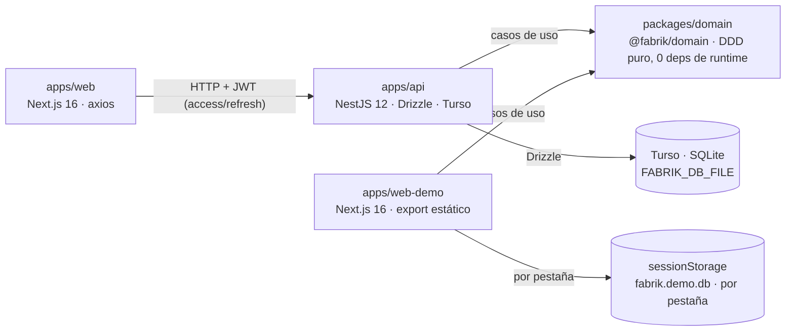

# fabrik-js

Sistema de gestión de fábrica en TypeScript: catálogos de materiales y ubicaciones,
máquinas y trabajadores, recetas con pasos y cantidades por unidad, asignaciones
máquina↔trabajador, arribo de suministros y producción completa
(iniciar → transformar → almacenar → completar), con stock por ubicación,
movimientos firmados y trazabilidad bidireccional (genealogía / recall).

Es un monorepo [pnpm](https://pnpm.io) + [Turborepo](https://turbo.build) con un
dominio DDD puro compartido (`@fabrik/domain`) que alimenta tres aplicaciones: la
API HTTP (NestJS + Drizzle + Turso), el panel de administración (Next.js) y una
demo autocontenida que ejecuta el mismo dominio en el navegador, sin backend.

[](https://github.com/beresiartejuan/fabrik-js/actions/workflows/ci.yml)
[](https://github.com/beresiartejuan/fabrik-js/actions/workflows/deploy-demo.yml)
[](LICENSE)


## Índice

1. [Demo en vivo](#demo-en-vivo)
2. [Arquitectura](#arquitectura)
3. [Puesta en marcha](#puesta-en-marcha)
4. [Scripts](#scripts)
5. [Estructura del repo](#estructura-del-repo)
6. [Roles y permisos](#roles-y-permisos)
7. [Licencia](#licencia)

## Demo en vivo

La demo está desplegada y disponible en:

**<https://beresiartejuan.github.io/fabrik-js/>**

Es un fork de `apps/web` donde **todas las llamadas de red fueron reemplazadas
por los casos de uso reales de `@fabrik/domain`**, ejecutados en el navegador.
No hay API, ni axios, ni peticiones: login, catálogos, producción, stock y
trazabilidad funcionan end-to-end sin backend. Los datos viven en
`sessionStorage` (clave `fabrik.demo.db`), así que **cada pestaña es un mundo
aparte** — lo que hagas en una no se ve en otra y se borra al cerrarla.
La base se siembra sola en el primer click (historia productiva completa) y el
botón **«Resetear demo»** del pie del sidebar la borra y re-siembra.

Inicio de sesión (nombre + contraseña):

| Usuario | Contraseña | Qué puede hacer |
|---|---|---|
| `admin` | `admin` | Todo: catálogos, recetas, agendas, iniciar producción, arribo. |
| `operario` | `operario` | Registrar transformaciones, arribos, almacenar/completar, ver stock. |
| `auditor` | `auditor` | Todo en **lectura** + stock, trazabilidad y eventos. |

Más detalle: [`apps/web-demo/README.md`](apps/web-demo/README.md) y el plan
completo en [`docs/11-plan-demo.md`](docs/11-plan-demo.md).

## Arquitectura



Toda operación productiva pasa por los **mismos casos de uso del dominio** y deja
rastro: movimientos de stock firmados (+/−), eventos por lote y genealogía
completa — de un lote a sus insumos, y de un suministro a los lotes afectados —
que sostiene los recalls. La API expone ese dominio sobre 45 rutas
REST con JWT manual (access + refresh, hashing `scrypt`) y OpenAPI generado desde
los schemas zod; la demo lo ejecuta directo en la pestaña con persistencia en
`sessionStorage`.

### Stack

| Capa | Tecnología | Versión |
|---|---|---|
| Monorepo | pnpm + Turborepo | pnpm `10.30.3` (pinado en `packageManager`) · turbo `^2.5.8` |
| Lenguaje | TypeScript, ESM en todo el workspace | `^6` en `domain`/`api` · `^5` en las apps web |
| Dominio | `@fabrik/domain` — DDD puro, cero dependencias de runtime, se publica compilado a `dist/` | Vitest `^4.1.2` para sus tests |
| API | NestJS (ESM) + Drizzle ORM + Turso (SQLite local vía `FABRIK_DB_FILE`) | Nest `^12.0.1` · drizzle-orm `1.0.0-rc.4` · `@tursodatabase/database` `0.8.3` |
| Validación / contrato | zod, OpenAPI generado con `@asteasolutions/zod-to-openapi` | zod `^4.6.7` |
| Web + demo | Next.js (App Router, React 19, `cacheComponents`) + Tailwind v4 + shadcn/ui | Next `16.4.2` · React `19.3.0` · Tailwind `^4` · shadcn `^4.22.0` |
| Cliente HTTP (solo `apps/web`) | axios con interceptores y refresh de sesión | `^1.20.0` |
| Calidad | Biome (lint + format, un solo binario en la raíz) | `2.5.15` |

## Puesta en marcha

Manual completo desde cero. No hace falta configurar nada más allá de lo que se
muestra: todos los secretos por defecto son de desarrollo.

### 1. Requisitos

- **Node.js ≥ 20** (`engines` del `package.json` raíz; el CI corre con Node 22, versión recomendada).
- **pnpm 10.30.3**, pinado en `packageManager`: con Corepack activado se usa la
  versión correcta automáticamente (`corepack enable`), o instálalo directo con
  `npm install -g pnpm@10`.
- **Git**.

### 2. Instalación

```bash
git clone https://github.com/beresiartejuan/fabrik-js.git
cd fabrik-js
pnpm install
```

### 3. Compilar el dominio (una vez)

`@fabrik/domain` se consume **compilado**: las apps resuelven `dist/index.js` vía
el `exports` del paquete. Turbo encadena el orden automáticamente (`dependsOn: ^build`),
así que basta un build inicial — y repetirlo después de cambiar el dominio:

```bash
pnpm build
```

### 4. API real (NestJS)

Pasos exactos para levantar la API con la base migrada y sembrada:

```bash
cp apps/api/.env.example apps/api/.env    # secretos y DB de desarrollo
pnpm --filter api db:migrate              # aplica migraciones sobre FABRIK_DB_FILE
pnpm --filter api db:seed                 # siembra la demo (idempotente)
pnpm --filter api start:dev               # watch en http://localhost:3001
```

- **Smoke test:** `GET http://localhost:3001/health` → `{"ok": true}`, y la UI de
  Swagger en <http://localhost:3001/docs> (JSON en `/docs-json`).
- **Usuarios del seed:** `admin`/`admin123`, `operario`/`operario123`,
  `auditor`/`auditor123`.
- El `.env.example` ya trae JWT dev secrets, `FABRIK_DB_FILE=./data/fabrik.db`,
  puerto `3001` y `CORS_ORIGINS=http://localhost:3000` (el origen del panel web).
  Detalle completo de variables y auth: [`apps/api/README.md`](apps/api/README.md).

### 5. Web de administración (contra la API)

La web **necesita la API del paso anterior corriendo**:

```bash
cp apps/web/.env.example apps/web/.env.local   # NEXT_PUBLIC_API_URL=http://localhost:3001
pnpm dev:web                                   # http://localhost:3000
```

Entra con las credenciales del seed (`admin`/`admin123`, `operario`/`operario123`,
`auditor`/`auditor123`). Si cambias `NEXT_PUBLIC_API_URL`, hay que reiniciar
`next dev`: las `NEXT_PUBLIC_*` se hornean en build time.

### 6. Demo sin API

```bash
pnpm dev:web-demo    # http://localhost:3000
```

Sin `.env`, sin migraciones ni seed: la base se siembra sola al primer click.
Credenciales de la demo: `admin`/`admin`, `operario`/`operario`, `auditor`/`auditor`.
Corre sobre `localhost`/`https` (el dominio genera ids con `crypto.randomUUID`,
que exige contexto seguro).

### 7. Verificación

```bash
pnpm check   # Biome en todo el repo (format + lint)
```

Y las suites (1.389 tests en total; todas en verde):

| Suite | Comando | Tests | Qué cubre |
|---|---|---:|---|
| Dominio | `pnpm --filter @fabrik/domain test` | 366 | Entidades, value objects, invariantes (I1–I7) y casos de uso con fakes in-memory. |
| API unit | `pnpm --filter api test` | 139 | Módulos NestJS, auth (JWT/scrypt), DTOs zod, serializadores. |
| API e2e | `pnpm --filter api test:e2e` | 105 | Las 45 rutas con supertest sobre SQLite temporal: RBAC por rol y errores de dominio → HTTP (404/403/409/422). |
| Web | `pnpm --filter web test` | 304 | Pantallas, guards por rol, cliente axios (interceptores, refresh) y módulos de datos. |
| Web demo | `pnpm --filter @fabrik/web-demo test` | 475 | El modo demo completo: capa `lib/api/demo` (sessionStorage, seed, auth opaca) sobre 54 archivos. |

## Scripts

Scripts raíz (`package.json`); los de dev arrancan una sola app vía filtros de pnpm:

| Script | Qué hace |
|---|---|
| `pnpm dev` | Todos los apps en watch, vía Turbo (API + web + demo). |
| `pnpm build` | Build completo: compila `@fabrik/domain` antes que sus consumidores. |
| `pnpm test` | Tests de todos los packages vía Turbo (requiere `dist/` del dominio). |
| `pnpm lint` | Lint de cada app vía Turbo (Biome). |
| `pnpm check` | `biome check .` en la raíz: formato, imports y lint de todo el repo. |
| `pnpm check:fix` | Lo mismo, con autocorrección (`biome check --write .`). |
| `pnpm format` | `biome format --write .` |
| `pnpm dev:api` | Solo la API (`start:dev`, puerto 3001). |
| `pnpm dev:web` | Solo la web de administración (puerto 3000). |
| `pnpm dev:web-demo` | Solo la demo (puerto 3000, sin API). |

Filtros de pnpm útiles (nombres de package: `api`, `web`, `@fabrik/web-demo`,
`@fabrik/domain`):

```bash
pnpm --filter @fabrik/domain typecheck   # tsc --noEmit del dominio (lo corre el CI)
pnpm --filter api db:seed                # utilidades de la API
pnpm --filter @fabrik/web-demo test      # suite de la demo
```

## Estructura del repo

```
fabrik-js/
├─ .github/workflows/     # CI (ci.yml) y deploy de la demo a GitHub Pages (deploy-demo.yml)
├─ apps/
│  ├─ api/                # API HTTP: NestJS 12, Drizzle + Turso, 45 rutas, OpenAPI en /docs
│  ├─ web/                # Panel de administración: Next.js 16, consume la API por HTTP
│  └─ web-demo/           # Fork de web sin backend: dominio en el navegador + sessionStorage
├─ docs/                  # 11 planes numerados: la fuente de verdad del proyecto
│  ├─ 01-vision-y-glosario.md … 07-arquitectura.md   # conceptuales: visión,
│  │                      #   modelo, flujo de producción, inventario, arquitectura
│  ├─ 08-plan-capa-de-dominio.md
│  ├─ 09-plan-de-api.md
│  ├─ 10-plan-de-web.md
│  └─ 11-plan-demo.md
├─ packages/
│  └─ domain/             # @fabrik/domain: entidades, VOs, casos de uso, eventos y puertos
└─ turbo.json · pnpm-workspace.yaml · biome.json
```

El dominio (`packages/domain`) es DDD puro: cero dependencias de runtime, cero
frameworks; los puertos son interfaces que la API implementa. Su documentación
Diátaxis vive en [`packages/domain/docs/index.md`](packages/domain/docs/index.md)
(explicación + referencia).

## Roles y permisos

Tres roles (ADMIN / WORKER / AUDITOR). El **RBAC real lo aplican los casos de uso
del dominio** (en la API emerge como `403`); la web solo filtra navegación con el
mismo criterio. Matriz de navegación de la UI (idéntica en `apps/web` y
`apps/web-demo`):

| Área | admin | operario (worker) | auditor |
|---|:---:|:---:|:---:|
| Dashboard (adaptado al rol) | ✓ | ✓ | ✓ |
| Catálogos: materiales, ubicaciones, máquinas, trabajadores | escribe | — | solo lectura |
| Recetas (pasos y cantidades por unidad) | escribe | — | solo lectura |
| Asignaciones máquina↔trabajador (agendas) | escribe | — | lectura |
| Producción: iniciar orden | ✓ | — | — |
| Producción: registrar transformación (pasos) | — | ✓ | — |
| Arribo de suministros / almacenar / completar | ✓ | ✓ | — |
| Stock por ubicación y movimientos | ✓ | ✓ (entrada manual de ids) | ✓ |
| Trazabilidad (genealogía / recall) y eventos | ✓ | — | ✓ |

Notas del dominio: un `admin` **no** registra transformaciones (worker-only), y
donde el `worker` no puede leer catálogos, sus pantallas degradan a entrada
manual de ids/unidad con indicación visible. Detalle: [`apps/web/README.md`](apps/web/README.md)
y [`docs/09-plan-de-api.md`](docs/09-plan-de-api.md).

## Licencia

Este proyecto está bajo la [licencia MIT](LICENSE).