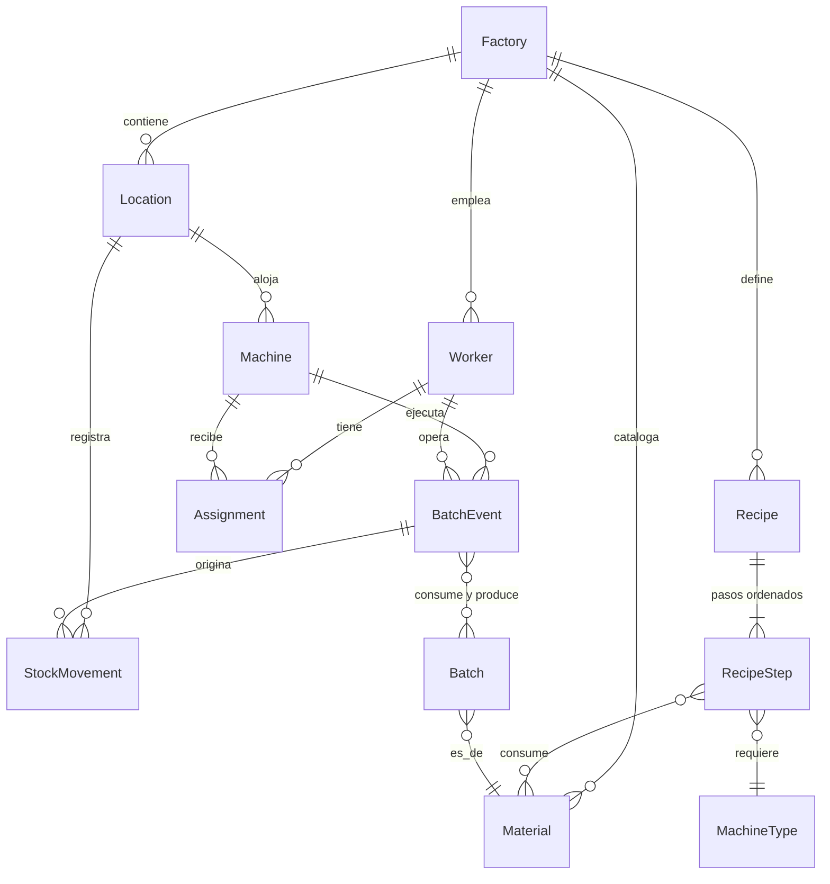

# Modelo de Dominio

Todas las entidades viven en `packages/domain`. Las identidades son value objects
opacos (`WorkerId`, `MachineId`, ...). Nada de este modelo depende de frameworks,
ORMs ni infraestructura.

## Entidades

### Factory
Raíz del contexto. Contiene los catálogos y la configuración.

```
Factory { id, name }
```

### Material (Supply | Product)
Catálogo flexible de ítems físicos. Product y Supply comparten estructura; se
distinguen por `kind`.

```
Material {
  id, name, description?,
  kind: 'supply' | 'product',
  physicalState: 'solid' | 'liquid' | 'gas',
  unitOfMeasure: UnitOfMeasure   // coherente con physicalState
}
```

Unidades de medida por estado:

| Estado | Unidades |
|---|---|
| solid | `g`, `kg`, `unit` (piezas) |
| liquid | `ml`, `l` |
| gas | `ml`, `l`, `m3` |

`unit` (unidades discretas) es válida solo para sólidos.

### Worker
```
Worker { id, name, role: 'admin' | 'worker' | 'auditor', active: boolean }
```
> El rol vive en el trabajador como dato de identidad; la autorización ocurre en
> los use cases.

### Location
```
Location {
  id, name,
  kind: 'production' | 'storage',   // contiene máquinas | almacena stock
}
```

### Machine
```
Machine {
  id, name, type: MachineType,      // el tipo habilita pasos de receta
  locationId,                        // debe ser location.kind === 'production'
  status: 'idle' | 'running' | 'maintenance'
}
```

### Recipe
Cadena ordenada e inmutable de pasos para fabricar un producto.

```
Recipe {
  id, name, outputProductId, outputQuantity: Quantity,
  steps: RecipeStep[]                // ordenados por position
}

RecipeStep {
  position: int (1..N),
  machineType: MachineType,          // qué tipo de máquina ejecuta el paso
  inputs: MaterialQuantity[],        // materials + Quantity requeridos
  outputProductId, outputQuantity    // típicamente producto intermedio
}
```

Reglas:
- El `outputProductId` del último paso debe ser el `outputProductId` de la receta.
- El output del paso N alimenta el input del paso N+1 (la validación estricta de
  compatibilidad puede ser laxa: los materiales intermedios se crean como
  `kind: 'product'`).

### Batch
Lote: instancia física trazable de un material.

```
Batch {
  id, materialId, quantity: Quantity,
  recipeId?,                          // null para lotes de suministro (ingreso)
  originBatchEventId?,                // evento que lo generó (null = ingreso externo)
  status: 'in_progress' | 'completed' | 'stored'
}
```

### BatchEvent
Registro inmutable de una transformación en máquina. **Es el corazón de la
trazabilidad.**

```
BatchEvent {
  id,
  machineId, workerId, locationId,
  recipeStepId/position?,             // paso de receta que se estaba ejecutando
  inputs:  BatchQuantity[],           // batches consumidos + cantidades
  outputs: BatchQuantity[],           // batches producidos + cantidades
  observation?: string,               // ← nota opcional del trabajador
  timestamp
}
```

Reglas:
- Inmutable: nunca se edita ni borra.
- `workerId` debe tener asignación vigente a `machineId` al momento del registro.
- Las cantidades de output pueden diferir del plan (mermas, desperdicios): se
  registra lo real.

### Assignment
Asignación horaria trabajador ↔ máquina (relación N a N con restricción).

```
Assignment { id, workerId, machineId, slot: TimeSlot }
```

### StockMovement
Movimiento de stock inmutable en un lugar de almacenamiento.

```
StockMovement {
  id, locationId, materialId,
  delta: StockDelta,                  // VO con signo (value-objects): positivo = entrada, negativo = salida
  reason: 'produced' | 'consumed' | 'supply_in' | 'manual_adjustment' | 'transfer_in' | 'transfer_out',
  batchEventId?,                      // evento de producción que lo originó
  timestamp
}
```

El **stock actual** de un material en un lugar es la suma de sus `StockMovement`.
No existe un campo editable de stock. Esto da trazabilidad nativa del inventario.

## Value Objects

```
Quantity   { amount: number, unit: UnitOfMeasure }   // amount > 0
TimeSlot   { daysOfWeek: Day[], start: HH:mm, end: HH:mm }
           + overlaps(other): boolean
```

- `Quantity` valida coherencia unidad/estado físico al combinarse con un Material.
- `TimeSlot.overlaps` se usa para el invariante de asignaciones.

## Relaciones



## Invariantes

1. **I1** — Un worker no puede tener dos `Assignment` cuyos `TimeSlot` solapen,
   sin importar la máquina. (No puede estar físicamente en dos lugares a la vez.)
2. **I2** — Una `Machine` solo puede ubicarse en un `Location` de kind `production`.
3. **I3** — Un `BatchEvent` solo lo puede registrar un worker con asignación
   vigente a esa máquina en ese horario.
4. **I4** — Los `BatchEvent` y `StockMovement` son inmutables.
5. **I5** — El stock nunca puede quedar negativo en un lugar (una salida requiere
   stock suficiente).
6. **I6** — Las `Quantity` de un `BatchEvent`/`StockMovement` deben ser coherentes
   con el `unitOfMeasure` del material.
7. **I7** — El `output` de la receta debe coincidir con el output de su último paso.
