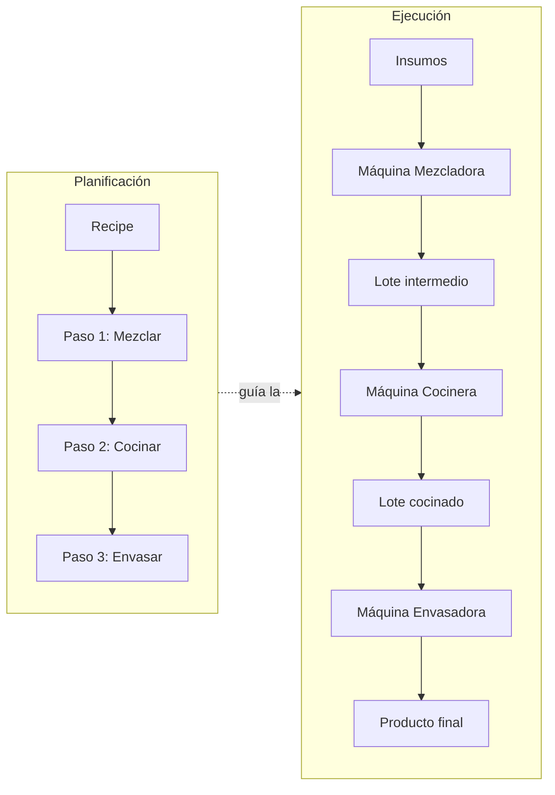

# Flujo de Producción

La producción combina un modelo **declarativo** (qué se planea hacer: `Recipe`)
con un modelo de **ejecución** (qué pasó realmente: `Batch` + `BatchEvent`).

## Visión general



## Narrativa del ciclo completo

1. **Ingreso de suministros**: llegan materias primas → se crean `Batch` de
   materiales `kind: supply` (sin recipe) y sus `StockMovement` de entrada en un
   `Location` de almacenamiento.
2. **Planificación**: el admin define/edita una `Recipe` con pasos ordenados.
   Ejemplo: "Jabón líquido" = Mezclar (máquina tipo Mixer) → Cocinar (tipo Cooker)
   → Envasar (tipo Filler).
3. **Inicio de producción**: `StartProduction(recipeId)` crea el lote raíz en
   estado `in_progress` y emite `BatchCreated`.
4. **Ejecución paso a paso**: un worker asignado a la máquina del paso registra
   `RecordTransformation(...)`:
   - consume batches de input (descuenta stock),
   - crea el batch de output,
   - escribe el `BatchEvent` con máquina, worker, inputs, outputs y observación
     opcional,
   - emite `BatchTransformed`.
5. **Almacenamiento intermedio**: entre pasos, el lote puede quedar `stored` en
   un lugar (movimientos de stock asociados), esperando la siguiente máquina.
6. **Finalización**: al completar el último paso, el lote pasa a `completed` y
   se emite `ProductionCompleted`. El producto final ingresa a stock del lugar
   destino.

## Trazabilidad y auditoría

`TraceBatch(batchId)` reconstruye la genealogía: siguiendo `originBatchEventId`
de cada `Batch` hacia atrás se obtiene el árbol completo.

```mermaid
flowchart BT
    S1[Batch aceite] --> E1[BatchEvent: Mezcla<br/>máquina M1, worker Juan<br/>obs: "mezcla espesa"]
    S2[Batch sosa] --> E1
    E1 --> I1[Batch mezcla cruda]
    I1 --> E2[BatchEvent: Cocinado<br/>máquina M2, worker Ana]
    E2 --> F[Batch jabón final]
```

Con ese árbol un **auditor** puede responder:
- ¿Qué suministros exactos forman este producto?
- ¿Qué máquinas y qué trabajadores intervinieron, en qué horario?
- ¿Hubo observaciones anómalas en algún paso?
- ¿Qué otros productos comparten un lote de suministro sospechoso?
  (trazabilidad hacia adelante: dado un `Batch` de suministro, listar todos los
  `BatchEvent` que lo consumieron y sus outputs → recall de productos).

## Reglas de ejecución

- El worker solo puede registrar transformaciones en máquinas a las que está
  asignado en el horario actual (invariante I3).
- Las cantidades reales de output pueden diferir de lo planeado (mermas): se
  registra la realidad, y la discrepancia queda visible al auditar.
- Los `BatchEvent` son inmutables: corregir un error = registrar un evento
  compensatorio, nunca editar el original.
