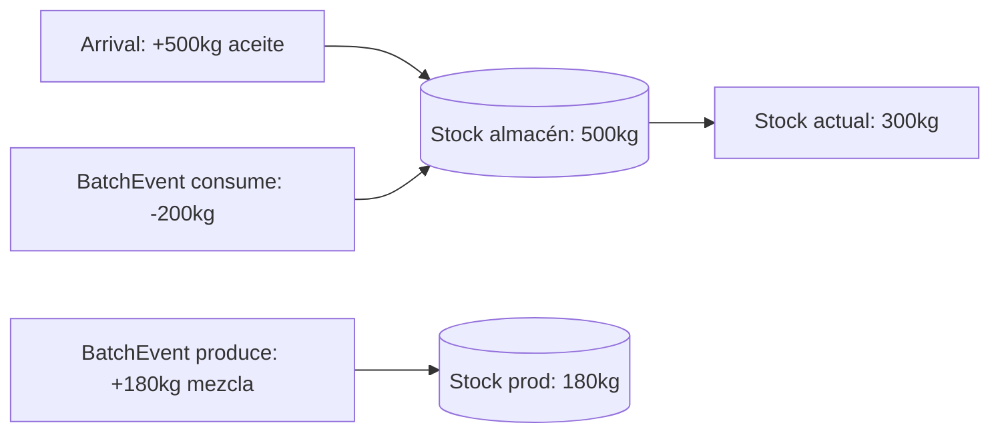

# Inventario

## Principio

**El stock no es un campo: es un agregado de movimientos.**

No existe `stock.quantity` editable. El stock actual de un material en un lugar
se calcula sumando sus `StockMovement` (`delta` positivo = entrada, negativo =
salida). Esto garantiza trazabilidad nativa: cada unidad presente en un lugar se
puede explicar por los movimientos que la trajeron.

## Modelo

```
StockMovement {
  id, locationId, materialId,
  delta: StockDelta,
  reason: 'produced' | 'consumed' | 'supply_in' | 'transfer_in' | 'transfer_out' | 'manual_adjustment',
  batchEventId?,       // set cuando reason es produced/consumed
  timestamp
}
```

| Reason | Cuándo | batchEventId |
|---|---|---|
| `produced` | Output de un BatchEvent ingresa a almacenamiento | sí |
| `consumed` | Input de un BatchEvent se consume | sí |
| `supply_in` | Ingreso externo de suministros | no |
| `transfer_in/out` | Movimiento entre lugares (par con signo opuesto) | no |
| `manual_adjustment` | Corrección de conteo físico (solo admin) | no |

> Nota: `transfer_out` está **declarado pero no implementado** (no existe un caso
> de uso de transferencia entre lugares; es deuda futura). `transfer_in` sí se usa
> hoy en `StoreBatch` para lotes sin evento de origen.



## Reglas

- **I5 (diferida)**: ninguna salida puede dejar el stock por debajo de cero. El
  diseño lo exige, pero `RecordTransformation` **todavía no lo valida** (decisión
  consciente: el consumo se descuenta en el lugar de la máquina y los outputs solo
  ingresan a stock en `StoreBatch`, así que una comprobación de no-negatividad en
  producción sería incoherente). Ver la nota de `RecordTransformation` en
  `docs/04-casos-de-uso.md`.
- Los movimientos son **inmutables** (I4). Corregir = nuevo movimiento
  compensatorio (`manual_adjustment` o un nuevo transfer).
- La trazabilidad stock ↔ producción se da por `batchEventId`: desde un
  movimiento se llega al evento, al trabajador, a la máquina y al lote.
- Fuera de scope (decisión tomada): capacidad máxima de lugares, reservas de
  stock, valoración monetaria.

## Consultas derivadas

- Stock actual por lugar: `SUM(delta) GROUP BY materialId WHERE locationId`.
- Stock global de un material: suma sobre todos los lugares.
- "¿De dónde salió este stock?": movimientos `produced` con sus eventos.
