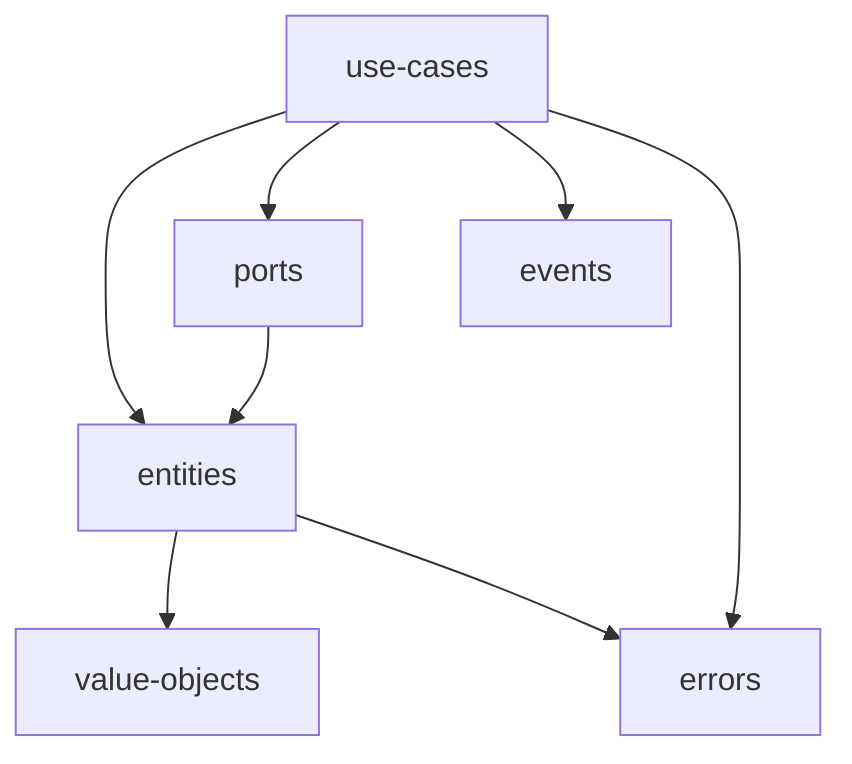

# Arquitectura

## Monorepo

```
fabrik-js/
  apps/
    api/        # NestJS — implementa puertos con Drizzle + Turso
    web/        # Next.js — consume entidades, VOs y validaciones del dominio
  packages/
    domain/     # ← capa de dominio compartida, sin dependencias externas
  docs/         # esta documentación
```

## `packages/domain` — estructura objetivo

```
packages/domain/
  package.json            # name: "@fabrik/domain", type: module
  src/
    entities/             # Material, Machine, Worker, Location, Recipe,
                          # Batch, BatchEvent, Assignment, StockMovement, Factory
    value-objects/        # Quantity, TimeSlot, ids (WorkerId, ...)
    use-cases/            # una clase/función por caso de uso
    events/               # DomainEvent + catálogo + EventBus (interfaz)
    ports/                # interfaces de repositorio + UnitOfWork
    errors/               # errores de dominio
    index.ts              # barrel export
```

### Dependencias permitidas



**Regla de oro:** el dominio no importa nada de NestJS, Next.js, Drizzle ni
`node:*`. Cero dependencias de runtime (idealmente cero `dependencies` en su
package.json, salvo tipos compartidos como zod *si se decide* usarlo para
validación de VOs — decisión a tomar al implementar).

## Puertos (interfaces) que el dominio define y la API implementa

```ts
MaterialRepository     // findById, list, save
MachineRepository
WorkerRepository
LocationRepository
RecipeRepository
BatchRepository
BatchEventRepository   // append-only
AssignmentRepository   // findByWorker (para validar solapamientos)
StockMovementRepository// append-only + sumByLocationAndMaterial
EventBus               // publish(event)
UnitOfWork             // transacciones para RecordTransformation
```

## Adaptadores en `apps/api`

- **Drizzle ORM** sobre **Turso (SQLite)** implementa cada repositorio con
  mappers tabla ↔ entidad. El esquema drizzle nace de estas entidades.
- NestJS inyecta las implementaciones en los use cases (los use cases del
  dominio son agnósticos al DI: reciben puertos por constructor).
- El bus de eventos inicial es in-process (`InMemoryEventBus`).

## Consumo desde `apps/web`

El front importa de `@fabrik/domain`:
- tipos (entidades, VOs) para modelar el estado de UI,
- validaciones puras reutilizables (coherencia Quantity/unidad, TimeSlot.overlaps
  para pre-validar asignaciones en formularios),
- nunca repositorios ni conexiones: habla con la API por HTTP.

## Testing del dominio

- Tests unitarios puros (vitest) sobre entidades, VOs y use cases con
  repositorios fake en memoria.
- Casos críticos a cubrir: invariante de solapamiento de horarios (I1), stock
  insuficiente (I5), autorización por rol, genealogía de `TraceBatch`.
