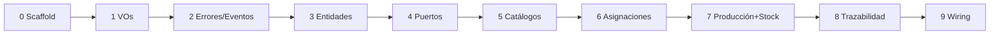

# Plan de Implementación — Capa de Dominio

**Alcance: únicamente `packages/domain`.** Sin tocar `apps/api` ni `apps/web`,
sin Drizzle, sin HTTP. Cada fase es mergeable y testeable de forma aislada.

## Fase 0 — Scaffolding del paquete ✅ (completada)

- [x] Crear `packages/domain` con `package.json` (`@fabrik/domain`, ESM,
      exports de `./src/index.ts`), `tsconfig.json` (strict), vitest.
- [x] Registrar en `pnpm-workspace.yaml` y `turbo.json` (tasks build/test).
      (No requirió cambios: root workspace ya cubría `packages/*` y turbo es genérico)
- [x] Scripts: `build` (tsc), `test` (vitest), `typecheck`.
- [x] Verificar: `pnpm --filter @fabrik/domain test` corre (con un test trivial).
      typescript ^6.0.2, vitest ^4.1.2.

## Fase 1 — Value objects e identidades ✅ (completada, 51 tests)

- [x] IDs tipados: branded strings con `create()`/`from()` para las 11 entidades.
- [x] `Quantity`: amount > 0, `add`/`subtract` misma unidad, lanza `InvalidQuantityError`.
- [x] `UnitOfMeasure` por estado físico + `isUnitCompatibleWith(state)`.
- [x] `TimeSlot`: daysOfWeek + start/end (semabierto [start,end)), `overlaps()`,
      `contains(date)`; rangos de medianoche rechazados.
- [x] Tests: arithmetic de Quantity (31), matriz de overlaps (14), ids (4).

## Fase 2 — Errores y eventos base ✅ (completada, +40 tests)

- [x] `errors/`: `DomainError` base + catálogo completo con contexto tipado
      (OverlappingSchedule, InsufficientStock, WorkerNotAssigned, InactiveMachine,
      RecipeIntegrity, UnauthorizedRole, IncompatibleUnit).
- [x] `events/`: union discriminada de eventos tipados + fábricas para el
      catálogo completo (docs/05) + interfaz `EventBus`.
- [x] Helper de testing `collectingEventBus()` (no exportado públicamente).
- [x] Tests: errors (22) + events (18).

## Fase 3 — Entidades ✅ (completada, +48 tests; total 139)

- [x] `Material` (valida unidad↔estado físico con `IncompatibleUnitError`).
- [x] `Location`, `Machine` (`moveTo` valida destino `production` — I2; creación
      validada en use cases, Fase 5).
- [x] `Worker` (roles, activate/deactivate).
- [x] `Recipe` + `RecipeStep` (posiciones consecutivas desde 1, I7).
- [x] `Batch` con máquina de estados: in_progress ↔ stored → completed (final).
- [x] `BatchEvent`, `StockMovement`, `Assignment`: inmutables por construcción.
- [x] Patrón uniforme: entidades inmutables con transiciones copy-on-write.
- [x] Errores nuevos: InvalidLocationKind, InvalidObservation (max 500),
      InvalidStateTransition, InvalidStockMovement.
- [x] `StockDelta` movido a value-objects (compartido con events).

## Fase 4 — Puertos ✅ (completada, +26 tests; total 165)

- [x] 9 interfaces de repositorio en `src/ports/` (findById → `T | null`,
      save = upsert; BatchEvent y StockMovement append-only).
- [x] `UnitOfWork` con estilo `run(fn(repos))` + agregado `Repositories`.
- [x] 9 fakes in-memory + `InMemoryUnitOfWork` + `inMemoryRepositories()`
      en `src/testing/` (fuera del barrel público).
- [x] Tests de contrato de los fakes (26).

## Fase 5 — Use cases: catálogos ✅ (completada, +83 tests; total 250)

- [x] Patrón: una clase por use case con deps inyectadas + `execute(actor, command)`;
      `Actor { workerId, role }` + guard `requireRole` (escritura: admin;
      lectura: admin+auditor; worker: nada en catálogos).
- [x] ABM de Material (se agregó `active`), Location (Update = rename-only),
      Machine (Create/Move validan I2 vía LocationRepository), Worker, Recipe (I7).
- [x] Reads con `NotFoundError` tipado; eventos emitidos donde docs/05 los
      define (material.created/updated, machine.created/moved).
- [x] Tests: happy path + UnauthorizedRole por rol indebido + I2 + NotFound + I7.

## Fase 6 — Use cases: asignaciones ✅ (completada, +24 tests; total 274)

- [x] `AssignWorkerToMachine` con **I1** (rechaza solapamiento, valida worker
      activo con nuevo `InactiveWorkerError`), `UnassignWorker`, agendas
      (`ListWorkerSchedule`, `ListMachineSchedule`; lectura A/Au).
- [x] Se agregó `findById` al puerto `AssignmentRepository`.
- [x] Tests: solapamiento mismo worker (otra y misma máquina, bordes de 1 min),
      adyacentes OK, distintos días OK, N workers misma máquina OK, inactivo,
      roles.

## Fase 7 — Use cases: producción e inventario ✅ (completada, +39 tests; total 313)

- [x] `RegisterSupplyArrival` (A/W; batch 'stored' + `supply_in`),
      `StartProduction` (A; batch raíz con cantidad planificada),
      `RecordTransformation` (W; transaccional vía UnitOfWork: evento +
      movimientos 'consumed' + batches de output), `StoreBatch` (→ 'produced' si
      hay evento origen, si no 'transfer_in'), `CompleteProduction` (A/W).
- [x] Validaciones: I3 (asignación vigente + `slot.contains(timestamp)`), I6,
      máquina en mantenimiento, actor = workerId.
- [x] **I5 diferido conscientemente** (documentado): los 'consumed' debitan la
      ubicación de la máquina mientras 'produced' acredita storage; chequear
      no-negatividad ahí sería incoherente. Se reevalúa con el flujo completo.
- [x] Tests: flujo completo de docs con merma y 7 eventos en orden + rechazos.

## Fase 8 — Trazabilidad ✅ (completada, +29 tests; total 342)

- [x] `TraceBatch` (árbol `BatchTraceNode` hacia atrás, guarda anti-ciclos),
      `TraceForward` (árbol `BatchForwardNode` de recall usando
      `listByInputBatchId` + filtro `originBatchEventId` agregado a BatchFilter).
- [x] `ListBatchEvents` con filtros + orden por timestamp.
- [x] `GetStockByLocation` (A/Au/W con `ALL_ROLES`; unidad desde el Material)
      y `GetStockMovements` (A/Au).
- [x] Fixes de la revisión aplicados: RecordTransformation rechaza transformación
      vacía y batchId duplicado (`InvalidTransformationError`), CompleteProduction
      valida receta primero (`NotAProductionOrderError`).

## Fase 9 — Publicación interna ✅ (completada)

- [x] Barrel `index.ts` completo y ordenado.
- [x] Agregar `@fabrik/domain: workspace:*` como dependencia en `apps/api` y
      `apps/web` (solo wiring del paquete, sin usarlo aún).
- [x] Documentar en `packages/domain/README.md` cómo importarlo.

## Orden y criterio de corte

**Done =** cada invariante I1–I7 con test verde, `pnpm test` verde en el paquete,
y el dominio compilable sin ninguna dependencia de runtime.
