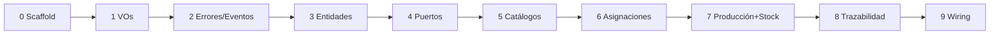

# Plan de Implementación — Capa de Dominio

**Alcance: únicamente `packages/domain`.** Sin tocar `apps/api` ni `apps/web`,
sin Drizzle, sin HTTP. Cada fase es mergeable y testeable de forma aislada.

## Fase 0 — Scaffolding del paquete ✅ (completada)

- [x] Crear `packages/domain` con `package.json` (`@fabrik/domain`, ESM,
      exports de `./src/index.ts`), `tsconfig.json` (strict), vitest.
- [x] Registrar en `pnpm-workspace.yaml` y `turbo.json` (tasks build/test).
      (No requirió cambios: root workspace ya cubría `packages/*` y turbo es genérico)
- [x] Scripts: `build` (tsc), `test` (vitest), `typecheck`.
- [x] Verificar: `pnpm --filter @fabrik/domain test` corre (con un test trivial).
      typescript ^6.0.2, vitest ^4.1.2.

## Fase 1 — Value objects e identidades ✅ (completada, 51 tests)

- [x] IDs tipados: branded strings con `create()`/`from()` para las 11 entidades.
- [x] `Quantity`: amount > 0, `add`/`subtract` misma unidad, lanza `InvalidQuantityError`.
- [x] `UnitOfMeasure` por estado físico + `isUnitCompatibleWith(state)`.
- [x] `TimeSlot`: daysOfWeek + start/end (semabierto [start,end)), `overlaps()`,
      `contains(date)`; rangos de medianoche rechazados.
- [x] Tests: arithmetic de Quantity (31), matriz de overlaps (14), ids (4).

## Fase 2 — Errores y eventos base ✅ (completada, +40 tests)

- [x] `errors/`: `DomainError` base + catálogo completo con contexto tipado
      (OverlappingSchedule, InsufficientStock, WorkerNotAssigned, InactiveMachine,
      RecipeIntegrity, UnauthorizedRole, IncompatibleUnit).
- [x] `events/`: union discriminada de eventos tipados + fábricas para el
      catálogo completo (docs/05) + interfaz `EventBus`.
- [x] Helper de testing `collectingEventBus()` (no exportado públicamente).
- [x] Tests: errors (22) + events (18).

## Fase 3 — Entidades (sin persistencia)

- [ ] `Material` (con `kind`, `physicalState`, validación de unidad).
- [ ] `Location`, `Machine` (valida destino `production` al moverse — I2).
- [ ] `Worker` (roles, `active`).
- [ ] `Recipe` + `RecipeStep` (orden de pasos, I7).
- [ ] `Batch`, `BatchEvent` (inmutables — factories, sin setters).
- [ ] `Assignment`, `StockMovement` (inmutable, delta con signo).
- [ ] Tests de factories y reglas de construcción.

## Fase 4 — Puertos

- [ ] Interfaces de repositorio (docs/07) + `UnitOfWork`.
- [ ] Fakes in-memory para tests (`packages/domain/src/testing/` o `__tests__/fakes`).

## Fase 5 — Use cases: catálogos

- [ ] ABM de Material, Location, Machine, Worker, Recipe con autorización
      por rol (A; lectura A/Au).
- [ ] Tests: happy path + `UnauthorizedRoleError` por rol indebido.

## Fase 6 — Use cases: asignaciones

- [ ] `AssignWorkerToMachine` con **I1** (rechazo por solapamiento),
      `UnassignWorker`, agendas.
- [ ] Tests: solapamiento mismo worker (rechaza), distintos workers misma
      máquina (acepta), horarios adyacentes sin solapar (acepta).

## Fase 7 — Use cases: producción e inventario

- [ ] `RegisterSupplyArrival`, `StartProduction`, `RecordTransformation`
      (transaccional vía UnitOfWork: evento + movimientos + batches),
      `StoreBatch`, `CompleteProduction`.
- [ ] Validaciones: I3 (asignación vigente), I5 (stock suficiente), I6
      (coherencia de unidades).
- [ ] Stock actual: query `getStock(locationId)` = suma de movimientos.
- [ ] Tests: flujo completo suministro → 2 pasos → producto final; intento de
      registrar sin asignación; stock negativo rechazado; eventos emitidos.

## Fase 8 — Trazabilidad

- [ ] `TraceBatch` (árbol hacia atrás) y `TraceForward` (hacia adelante).
- [ ] `ListBatchEvents` con filtros.
- [ ] Tests: genealogía de 3 niveles; recall (lote de suministro → N productos).

## Fase 9 — Publicación interna

- [ ] Barrel `index.ts` completo y ordenado.
- [ ] Agregar `@fabrik/domain: workspace:*` como dependencia en `apps/api` y
      `apps/web` (solo wiring del paquete, sin usarlo aún).
- [ ] Documentar en `packages/domain/README.md` cómo importarlo.

## Orden y criterio de corte

**Done =** cada invariante I1–I7 con test verde, `pnpm test` verde en el paquete,
y el dominio compilable sin ninguna dependencia de runtime.
