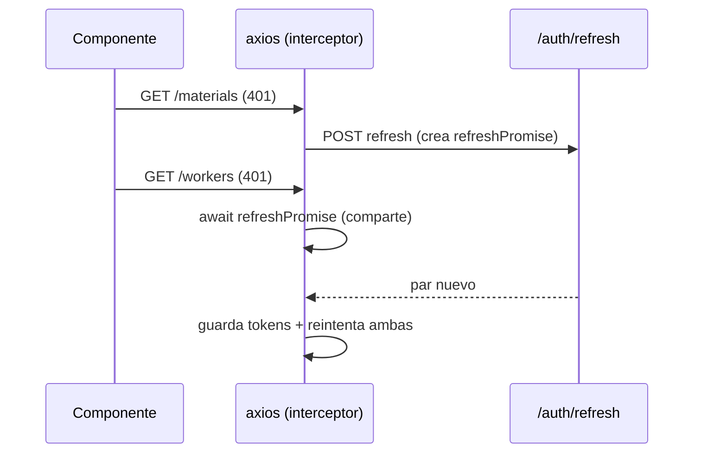

# Plan de Implementación — Web (`apps/web`)

**Alcance: únicamente `apps/web`.** Frontend Next 16 + React 19 + Tailwind v4 + vitest que
consume `apps/api` por HTTP. No toca dominio ni API; los huecos de endpoints que aparecen
se registran como *gaps* al final, no se inventan rutas.

Decisiones ya fijadas (no se reabren en este plan):

- **HTTP: axios** con una **instancia compartida** (`baseURL` desde `NEXT_PUBLIC_API_URL` +
  interceptores). El transporte vive en una **capa de API tipada por recurso**; los
  componentes **nunca** llaman a axios directamente.
- **Sesión: `sessionStorage`**, con **ambos** tokens (access + refresh). El interceptor de
  respuesta resuelve `401 → POST /auth/refresh` (refresh **single-flight**) → reintenta la
  petición original; si el refresh falla → logout + `redirect('/login')`.
- **UI: shadcn/ui + Tailwind v4.** `shadcn init` en `apps/web`; los componentes se añaden
  por fase según se necesiten.
- **Idioma: español.** Fechas y cantidades con formato consistente (`Intl` + helper propio).
- **Tipos:** DTOs de wire explícitos en `apps/web/src/lib/api/types.ts` espejando los
  serializadores de la API; se importan *unions* del dominio (`UnitOfMeasure`,
  `WorkerRole`, `MachineStatus`, …) como *type-only* cuando aporta.
- **Orquestación:** implementación fase por fase por subagentes. Cada fase termina **verde**
  (vitest + build + biome) con un **commit local** (Conventional Commits en inglés,
  **nunca push**).

## Reglas de trabajo (leer antes de escribir código)

1. **Este Next 16 no es el Next que conocés.** Antes de tocar código, cada subagente debe
   leer la guía correspondiente en `apps/web/node_modules/next/dist/docs/` (App Router,
   routing, data fetching, metadata) — lo exige `apps/web/AGENTS.md`. El bloque
   `BEGIN:nextjs-agent-rules` que añade `next dev` se commitea junto con el trabajo.
2. **shadcn/ui sobre Tailwind v4.** Inicializar con `pnpm dlx shadcn@latest init` en
   `apps/web`; añadir componentes con el flujo de shadcn y respetar los patrones de
   Tailwind v4 (`@theme inline`, variables CSS). No reinventar primitivas ni traer otra
   librería de UI.
3. **Nunca axios en componentes.** Todo pasa por `lib/api/modules/*`. El acceso a datos
   desde React usa hooks que envuelven esos módulos.
4. **Español** en toda la UI, mensajes de error y estados vacíos.
5. Cada fase cierra **verde** (`pnpm --filter web test && pnpm --filter web build &&
   pnpm --filter web lint`) y con **commit local**; nunca push.

---

## Arquitectura del front (decidida)

### App shell client-rendered

Recomendación: **toda la aplicación se renderiza en cliente**. El motivo es que los tokens
viven en `sessionStorage`, que no existe en el servidor; un shell SSR obligaría a un
bootstrap de sesión en cliente igualmente y añadiría hidratación y estados intermedios sin
beneficio para una herramienta interna. El grupo `(app)` usa `'use client'` en su layout y
las páginas; `layout.tsx` raíz queda mínimo (fuentes, `lang="es"`, metadata).

```
apps/web/src/app/
├─ layout.tsx                    # raíz: fuentes, lang="es", metadata
├─ login/page.tsx                # público (sin sidebar)
├─ (app)/
│  ├─ layout.tsx                # guard + sidebar + topbar
│  ├─ page.tsx                  # dashboard (rol-aware)
│  ├─ materiales/page.tsx       ├─ ubicaciones/page.tsx
│  ├─ maquinas/page.tsx         ├─ trabajadores/page.tsx
│  ├─ recetas/page.tsx  recetas/nueva/page.tsx  recetas/[id]/page.tsx
│  ├─ asignaciones/page.tsx     ├─ stock/page.tsx
│  ├─ produccion/page.tsx  produccion/nueva/page.tsx  produccion/registrar/page.tsx
│  ├─ suministros/arribo/page.tsx
│  ├─ trazabilidad/page.tsx     └─ eventos/page.tsx
```

Guardas: `RequireAuth` envuelve `(app)` (sin `workerId` en sesión → `redirect('/login')`) y
`RequireRole roles={['admin']}` protege las pantallas de escritura. La navegación del
sidebar se filtra por rol (misma matriz que la API: el RBAC real lo decide el dominio y se
traduce a 403). Las pantallas de fases futuras se marcan con `enabled: false` en
`src/lib/nav.ts` y no se renderizan (sidebar ni CTAs del dashboard) hasta que existan.

### Capa HTTP (axios)

```
apps/web/src/lib/
├─ api/
│  ├─ client.ts     # instancia axios + interceptores (request y response)
│  ├─ types.ts      # wire DTOs (espejo de los serializadores de la API)
│  ├─ errors.ts     # ApiError + errorToMessage() (español)
│  └─ modules/      # authApi, materialsApi, locationsApi, machinesApi, workersApi,
│                   # recipesApi, assignmentsApi, suppliesApi, productionApi,
│                   # stockApi, traceApi, batchEventsApi
├─ session/session-store.ts   # sessionStorage + SessionProvider + useSession()
├─ format/          # quantity.ts, date.ts, units.ts, days.ts
└─ hooks/useApiQuery.ts       # helper mínimo de fetch/estados (sin dependencias nuevas)
```

`client.ts`:

- `axios.create({ baseURL: process.env.NEXT_PUBLIC_API_URL })`.
- **Request interceptor:** si hay access token, `Authorization: Bearer <access>`.
- **Response interceptor:**
  - `401` (y la petición no es `/auth/login` ni `/auth/refresh`, y no lleva ya el flag
    `_retry`): ejecuta `refreshTokens()` **single-flight** y reintenta la original con el
    token nuevo.
  - Si el refresh falla: limpia la sesión y `window.location.assign('/login')`.
  - Cualquier otro error se normaliza a `ApiError` y se re-lanza.

**Single-flight (clave):** el refresh en vuelo se guarda en una variable de módulo
(`refreshPromise`); los `401` concurrentes **comparten** esa promesa en vez de disparar N
refresh rotativos (rotar el refresh invalida el anterior → cascada de fallos). Es el caso
que más tests unitarios exige (ver *Testing*).



### Wire DTOs (`types.ts`)

Espejo explícito de los serializadores de `apps/api`: `QuantityWire { amount, unit }`,
`TimeSlotWire { daysOfWeek, start, end }`, `MaterialWire`, `LocationWire`, `MachineWire`,
`WorkerWire`, `RecipeStepWire`/`RecipeWire`, `AssignmentWire`, `BatchWire`,
`BatchEventWire` (con `timestamp: string` ISO 8601), `StockMovementWire`,
`StockByLocationEntryWire`, `BatchTraceNodeWire`/`BatchForwardNodeWire`,
`AuthTokensWire { accessToken, refreshToken, tokenType, expiresIn }`,
`ActorWire { workerId, role }`, `ApiErrorBody { statusCode, error, message, context? }`.

Decisión: los **IDs viajan como `string`** en los DTOs (los *branded ids* del dominio no
aportan en runtime y añaden fricción al deserializar JSON); se reutilizan del dominio las
*unions* literales (`UnitOfMeasure`, `WorkerRole`, `MaterialKind`, `PhysicalState`,
`MachineStatus`, `LocationKind`, `BatchStatus`, `StockMovementReason`) con `import type`.

### Errores → mensajes

El `DomainExceptionFilter` responde `{ statusCode, error, message, context? }` donde
`error` es el **nombre** de la clase de dominio. `errors.ts` expone `ApiError` y
`errorToMessage()`:

| `error` / status | Mensaje (español) |
|---|---|
| `OverlappingScheduleError` (409) | "El trabajador ya tiene una asignación en ese horario." |
| `InsufficientStockError` (409) | "Stock insuficiente para esa salida." |
| `WorkerNotAssignedError` (409) | "No estás asignado a esa máquina en este horario." |
| `InactiveMachineError` (409) | "La máquina no está operativa (mantenimiento)." |
| `InvalidStateTransitionError` (409) | "El lote no admite esa transición de estado." |
| `IncompatibleUnitError` / `RecipeIntegrityError` (422) | "Unidad o receta incompatible." (usar `message`/`context`) |
| `InvalidTransformationError` (422) | "La transformación no es válida (vacía o con inputs repetidos)." |
| 403 | "No tenés permisos para esta acción." |
| 404 | "No se encontró el recurso." |
| 500 | "Ocurrió un error inesperado." |

`401` no llega a la UI: lo resuelve el interceptor.

### Formato

- **Cantidades:** `${amount} ${unitLabel}` (`units.ts`: `g`,`kg`,`l`,`ml`,`m³`, `unit` →
  "u"). Reutiliza `Quantity` del dominio para validar en formularios.
- **Fechas:** `Intl.DateTimeFormat('es', { dateStyle:'short', timeStyle:'short' })`.
- **Franjas:** días `0=domingo…6=sábado` → "dom, lun, …"; horas `HH:mm`.
- **TimeSlot:** al pre-validar solapamientos en el front se instancia
  `TimeSlot.create(daysOfWeek, start, end)` y se usa `overlaps`/`contains` (dominio puro).

---

## Pantallas

| # | Ruta | Propósito | Roles | Datos (endpoints) |
|---|---|---|---|---|
| 1 | `/login` | Login por nombre + contraseña | público | `POST /auth/login`, `GET /auth/me` |
| 2 | `/` | Dashboard rol-aware | A/W/Au | `GET /auth/me`, `GET /me/schedule`, `GET /batch-events`, `GET /materials`, `GET /machines`, `GET /workers` |
| 3 | `/materiales` | Catálogo de materiales | A / Au (lectura) | `GET/POST /materials`, `PATCH /materials/:id`, `POST /materials/:id/deactivate` |
| 4 | `/ubicaciones` | Catálogo de lugares | A / Au | `GET/POST /locations`, `PATCH /locations/:id` |
| 5 | `/maquinas` | Catálogo de máquinas | A / Au | `GET/POST /machines`, `PATCH /machines/:id`, `POST /machines/:id/move` |
| 6 | `/trabajadores` | Catálogo de trabajadores | A / Au | `GET/POST /workers`, `PATCH /workers/:id`, `POST /workers/:id/deactivate` |
| 7 | `/recetas` (+ `/recetas/nueva`, `/recetas/[id]`) | Recetas + builder de pasos | A / Au | `GET /recipes`, `POST /recipes`, `PATCH /recipes/:id`, `GET /materials` |
| 8 | `/asignaciones` | Grilla horaria máquina/worker | A / Au | `GET /machines`, `GET /workers`, `GET /machines/:id/schedule`, `GET /workers/:id/schedule`, `POST /assignments`, `DELETE /assignments/:id` |
| 9 | `/produccion` | Producciones activas (lotes en curso) | A/W/Au | `GET /batches?status=in_progress` (gap resuelto), `GET /batches/:id` (buscador) |
| 10 | `/produccion/nueva` | Iniciar producción desde receta | A | `GET /recipes`, `POST /production/start` |
| 11 | `/produccion/registrar` | Registrar transformación | W | `GET /auth/me`, `GET /me/schedule`, `GET /batches` (picker de inputs; `/batch-events` es A/Au), `POST /production/transform`, `POST /production/store`, `POST /production/complete` |
| 12 | `/suministros/arribo` | Arribo de suministros | A/W | `GET /materials?kind=supply`, `GET /locations?kind=storage` (A/Au: worker → entrada manual), `POST /supplies/arrivals` |
| 13 | `/stock` | Stock por lugar + movimientos | A/Au/W | `GET /locations`, `GET /stock/:locationId`, `GET /stock/:locationId/movements`, `GET /materials` |
| 14 | `/trazabilidad` | Genealogía atrás + recall adelante | A/Au | `GET /trace/:batchId`, `GET /trace/:batchId/forward`, `GET /batch-events` |
| 15 | `/eventos` | Listado de eventos filtrado | A/Au | `GET /batch-events`, `GET /machines`, `GET /workers`, `GET /materials` |

### 1. `/login`

Público, sin sidebar. Campos `name` + `password`; al enviar, `authApi.login` guarda el par en
`sessionStorage` y redirige a `/`. Estados: loading (botón deshabilitado), error 401
("Nombre o contraseña incorrectos"), error de red ("No se pudo contactar al servidor").
Si ya hay sesión, redirige a `/`.

### 2. `/` (dashboard)

**Simple en v1** — tarjetas y listas, sin gráficos.

- **Admin:** accesos a Catálogos + acciones rápidas ("Nueva producción", "Registrar
  arribo") + contadores de catálogo (`materials`/`machines`/`workers` activos, desde los
  listados).
- **Worker:** "Mis máquinas de ahora" desde `GET /me/schedule` (asignaciones +
  máquina resuelta + `activeNow` **calculado en el servidor**) con botón directo a
  registrar, y acceso a "Arribo de suministros". Ya no se recalcula el horario en
  cliente.
- **Auditor:** últimos eventos (`GET /batch-events`, recorte en cliente) + accesos a `/stock`
  y `/trazabilidad`.

Cargar los datos según rol; estados de loading con skeletons y vacío ("Todavía no hay
máquinas asignadas").

### 3–6. Catálogos (`/materiales`, `/ubicaciones`, `/maquinas`, `/trabajadores`)

Mismo patrón: título + botón "Nuevo" (solo admin) → **diálogo shadcn** con el formulario;
tabla con búsqueda/orden local, badges de estado y acciones por fila (Editar, Dar de baja,
Mover para máquinas). Auditor ve la tabla sin acciones de escritura.

- Materiales: `name`, `description`, `kind` (supply/product), `physicalState`, y
  `unitOfMeasure` **filtrada por estado físico** (`unitsForPhysicalState` del dominio) para
  no ofrecer combinaciones inválidas. Baja lógica (`deactivate`).
- Ubicaciones: `name`, `kind` (production/storage); Editar solo renombra.
- Máquinas: `name`, `type` (texto libre con `datalist` de tipos existentes), `locationId`
  (solo lugares de producción) y acción Mover (`POST /machines/:id/move`). **El estado
  (`status`) es solo lectura en v1** (la API no expone transiciones — ver gaps).
- Trabajadores: `name`, `role`, activo. Baja lógica. Sin reactivación (gap de API ya
  anotado en `docs/09`): el botón "Reactivar" queda deshabilitado con nota.

### 7. `/recetas` — builder (el formulario más complejo)

Lista (`GET /recipes`) con nombre, producto de salida y nº de pasos. Crear/editar abre una
**página dedicada** (`/recetas/nueva`, `/recetas/[id]`) porque el builder no cabe en un
diálogo.

Builder:

- **Cabecera:** `name`, `outputProductId` (select de productos, `GET /materials?kind=product`),
  `outputQuantity` (`amount` + `unit` derivada del material).
- **Pasos ordenados:** lista con añadir/eliminar y subir/bajar; la posición se **recalcula
  1..N** al reordenar. Cada paso: `machineType` (datalist de tipos de máquina existentes),
  `inputs` (filas repetibles: material + cantidad), `outputProductId` + `outputQuantity`.
- **Validación en cliente (pre-flight, mensajes inline):** al menos un paso; posiciones
  consecutivas; **I7** — el output del último paso debe coincidir con el `outputProductId`
  de la receta. La unidad se restringe por material. La integridad final la revalida el
  dominio (`RecipeIntegrityError` → 422) y se muestra mapeada.
- **Guardar:** `POST /recipes` o `PATCH /recipes/:id`; enviar `steps` **reemplaza la lista
  completa** (semántica de la API: no es merge por posición).

### 8. `/asignaciones`

Vista de agenda. Selector de **máquina** → `GET /machines/:id/schedule`; y selector de
**worker** → `GET /workers/:id/schedule`. Se muestra una grilla semanal (columnas lun–dom,
filas = asignaciones del rango) o una lista agrupada por worker.

- **Asignar** (admin): diálogo con worker activo, máquina y **editor de `TimeSlot`** (días
  como checkboxes + `start`/`end` `HH:mm`). Pre-validación con `TimeSlot.overlaps` contra la
  agenda del worker ya cargada → aviso inmediato "Ese horario se solapa con otra
  asignación". El servidor impone I1: `OverlappingScheduleError` (409) se mapea al mismo
  mensaje amigable.
- **Desasignar:** `DELETE /assignments/:id` con confirmación.
- Estados: vacío ("Sin asignaciones para esta máquina"), error de solapamiento como toast.

### 9. `/produccion`

Lista de **producciones activas** (lotes `in_progress`) con enlace a trazabilidad y acción
"Registrar transformación". **Gap resuelto:** la API ya expone `GET /batches` (filtros
`status`/`materialId`/`recipeId`/`originBatchEventId`) y `GET /batches/:id`, así que la lista
se carga del servidor (`GET /batches?status=in_progress`) en vez del `sessionStorage` de v1.
Ver *gaps*.

### 10. `/produccion/nueva` (admin)

Select de receta (`GET /recipes`) con vista previa de pasos → `POST /production/start
{ recipeId }` → redirige a `/produccion` mostrando el lote creado. Estado de error:
receta inexistente (404).

### 11. `/produccion/registrar` (worker)

- **Máquina:** selector con **solo las máquinas asignadas al worker en este momento**,
  tomadas de `GET /me/schedule` (la asignación ya trae la máquina resuelta y
  `activeNow` calculado server-side). Si el worker elige una máquina fuera de franja,
  la API responde 409 (`WorkerNotAssignedError`) y se muestra el aviso. La vigencia
  de I3 **no se recalcula en el cliente**.
- **Paso de receta (opcional):** `recipeStepId` derivado de la receta del lote, filtrado por
  tipo de máquina.
- **Inputs:** filas `{ batchId, quantity }` desde el `GET /batches` (A/Au/W), que
  trae material, cantidad y estado por lote; se excluyen los `completed`. La
  unidad sale del lote (el dominio no revalida la unidad de los inputs).
- **Outputs:** filas `{ materialId, quantity }`; material desde `GET /materials`,
  unidad por defecto `material.unitOfMeasure`. **Para un worker** (sin lectura de
  catálogo) la fila va manual: id + unidad elegida, que la API revalida (I6).
- **Observación:** textarea con contador, máximo 500 (`MAX_OBSERVATION_LENGTH` del dominio).
- **Enviar:** `POST /production/transform` → respuesta `{ event, outputBatches }`; muestra
  los lotes creados y ofrece "Almacenar lote" (`POST /production/store`) y "Completar"
  (`POST /production/complete`, sobre la orden raíz que trae `recipeId`). Errores 409/422 mapeados.

### 12. `/suministros/arribo`

Materiales `kind=supply` + cantidad (unidad derivada del material) + lugar `storage` →
`POST /supplies/arrivals`. Éxito: toast con el lote creado (`stored`) y opción de registrar
otro. Errores: material no suministro / lugar no almacén (422).

### 13. `/stock`

Selector de lugar (`GET /locations`, producción y almacén) → `GET /stock/:locationId` en
tabla (material resuelto por nombre, `amount`, `unit`; en lugares de **producción** los
consumos aparecen con `amount` **negativo**, se muestra con signo/color). Selección de fila
abre un **drawer** con movimientos `GET /stock/:locationId/movements?materialId=` (fecha,
delta, motivo en español, enlace a `batchEventId`). **Gap:** no hay stock global por
material; v1 es siempre por lugar. Worker puede leer stock (200); no ve movimientos (403).

### 14. `/trazabilidad`

Buscador por **ID de lote** (input + helper "lotes recientes" desde `/batch-events`).
`GET /trace/:batchId` renderiza el **árbol hacia atrás** con un componente recursivo: cada
nodo muestra el lote (material, cantidad, estado) y, si existe, su evento (máquina, worker,
timestamp, observación); badge "ciclo detectado" si el wire trae `cycleDetected`. Pestaña
**Recall** con `GET /trace/:batchId/forward` (nodos de lote **o** evento, nunca ambos).
Errores: 404 lote desconocido. **Gap:** no se puede buscar por material/nombre/fecha.

### 15. `/eventos`

Filtros: máquina, worker (selects de catálogo), material y rango `from`/`to` (ISO) →
`GET /batch-events`. Tabla cronológica: timestamp, máquina, worker, inputs, outputs,
observación. Sin paginación (gap): v1 recorta la visualización en cliente. Solo admin y
auditor.

---

## Fase 0 — Base, capa HTTP, sesión, shell y login ✅ (completada)

- [x] Dependencias: `axios`; `shadcn init` en `apps/web` (Tailwind v4) + componentes base
      (`button`, `input`, `label`, `card`, `dialog`, `table`, `sonner`/`toast`, `badge`,
      `skeleton`, `dropdown-menu`, `select`, `tabs`, `sheet`).
- [x] `.env.local`/`.env.example` con `NEXT_PUBLIC_API_URL`.
- [x] `lib/api/client.ts`: instancia axios + request interceptor (Bearer) + response
      interceptor con **refresh single-flight**, reintento y logout/redirect.
- [x] `lib/api/types.ts`, `lib/api/errors.ts` (+ `ApiError`, `errorToMessage`) y `modules/authApi.ts`.
- [x] `lib/session/session-store.ts`: `sessionStorage` (ambos tokens) + `SessionProvider`/`useSession`.
- [x] `lib/format/*` (unidades, días, fechas, cantidades) y `hooks/useApiQuery.ts`.
- [x] `/login` + `RequireAuth` + `RequireRole`, layout raíz `lang="es"`, layout `(app)` con
      **sidebar por rol** y topbar con "Cerrar sesión".
- [x] Dashboard `/` rol-aware (versión simple de la sección 2).

> Nota histórica: **Fase 0a** aterrizó las *librerías* de Fase 0 (deps/shadcn, env, capa HTTP
> axios, DTOs de wire, `ApiError`/`errorToMessage`, `authApi`, store de sesión, formateadores
> y `useApiQuery`) con tests unitarios; **Fase 0b** aterrizó las pantallas y guardas
> (`/login`, `(app)`, dashboard rol-aware).

**✅ Completada:** el shell client-rendered cierra Fase 0:

- **Rutas:** raíz mínima en `src/app/layout.tsx` (`lang="es"`, fuentes, metadata,
  `SessionProvider` + `Toaster`); `src/app/login/page.tsx` (público, campos nombre +
  contraseña, `Field`/`FieldGroup`, 401 → "Nombre o contraseña incorrectos", error de red,
  ya-logged-in → `/`); grupo `src/app/(app)/` con `layout.tsx` (guard + sidebar + topbar) y
  `page.tsx` (dashboard rol-aware). Se retiró el scaffold `src/app/page.tsx`.
- **Guardas** (`src/components/guards.tsx`): `RequireAuth` redirige a `/login` sin sesión y
  muestra `PageLoading` durante la hidratación (además resuelve el `Actor` con `GET /auth/me`
  si la sesión tiene tokens pero no worker); `RequireRole` redirige al dashboard (`/`) ante
  un rol indebido (decisión documentada: la navegación ya filtra por rol y el RBAC real es
  del dominio → 403).
- **Sidebar por rol:** hand-rolled con primitivas de shadcn (`sheet` en mobile) y la matriz
  de `src/lib/nav.ts` (misma que la tabla de *Pantallas*; un `admin` **no** ve "Registrar
  transformación"). Topbar con nombre + rol y "Cerrar sesión" (`POST /auth/logout` → limpieza
  local → `/login`).
- **Dashboard `/`:** admin → contadores (`materials`/`machines`/`workers`), acciones rápidas
  y accesos a catálogos; worker → "Mis máquinas de ahora" desde `GET /me/schedule`
  (`activeNow` server-side; sin recálculo en cliente); auditor → últimos eventos
  (`GET /batch-events`, recorte en cliente) + accesos a `/stock`/`/trazabilidad`.
  Skeletons y estados vacíos en español.
- **Módulos de API nuevos** (mínimos para el dashboard): `materialsApi`, `machinesApi`,
  `workersApi`, `batchEventsApi`, `assignmentsApi` (agendas) y `meApi` (`GET /me/schedule`).
  `session-store` gana un `name`
  opcional (el login lo persiste) para el topbar, ya que `GET /auth/me` no expone el nombre y
  `GET /workers/:id` es A/Au.

Verificación: `pnpm --filter web test` (**70 tests**; neto +12: 14 nuevos —nav 7,
guards 4, login 3— menos los 2 del smoke del scaffold retirado), `pnpm --filter web build`
y `pnpm --filter web lint` (biome) verdes.

**Criterio de salida:** login real contra la API (seed `admin`/`admin123`) navega al
dashboard; el sidebar muestra secciones según rol; sin token, cualquier ruta privada
redirige a `/login`. Vitest verde para el interceptor (single-flight, reintento, logout),
`errorToMessage` y el store de sesión. `build` + `lint` (biome) verdes.

## Fase 1 — Catálogos base ✅ (completada)

- [x] Componentes reutilizables: `DataTable` (búsqueda/orden/estado vacío), `ConfirmDialog`,
      `FormDialog`, `StatusBadge`, `EmptyState`.
- [x] `/materiales`, `/ubicaciones`, `/maquinas`, `/trabajadores` con list + diálogo de
      alta/edición, baja lógica y "Mover" (máquinas).
- [x] Módulos `materialsApi`, `locationsApi`, `machinesApi`, `workersApi`.
- [x] Unidades filtradas por estado físico; solo lugares de producción para máquinas.
- [x] Gating de escritura con `RequireRole`/`canWrite`.

**✅ Completada:** los cuatro catálogos quedan operativos:

- **Componentes reutilizables** (`src/components/shared/`): `DataTable` (genérica y
  tipada; búsqueda y orden locales, estado vacío y estado de "sin resultados" en
  español), `ConfirmDialog` (maneja `busy`, cierra solo si la promesa resuelve),
  `FormDialog` (título/descripción/children/footer), `StatusBadge` (tonos sobre
  `Badge`), `EmptyState`, más `SelectField` (Select de shadcn + label), `RowActions`
  (menú por fila), `QueryError` (bloque de error con "Reintentar") y `PageHeader`
  (movido desde `dashboard-common`, que lo reexporta). Las etiquetas/tonos en español
  de las *unions* del dominio viven en `src/lib/format/labels.ts`; el toast de error
  se centraliza en `useErrorToast`.
- **Módulos de API completados** contra los controladores reales:
  `materialsApi` (`list` con `kind`/`physicalState`, `get`, `create`, `update`,
  `deactivate`), `locationsApi` (nuevo: `list` con `kind`, `get`, `create`, `update`
  —`PATCH` solo renombra—), `machinesApi` (`list` con `locationId`/`status`/`type`,
  `get`, `create`, `update`, `move` por `POST /machines/:id/move`) y `workersApi`
  (`list` con `role`/`active`, `get`, `create`, `update`, `deactivate`). Los tipos de
  entrada reproducen los schemas zod de la API.
- **Pantallas** (lógica en `src/components/catalogs/*`, rutas finas en `src/app/(app)/`):
  `/materiales` (tabla nombre/descripción/tipo/estado físico/unidad/activo + alta/edición
  con **unidades filtradas por `unitsForPhysicalState`** + baja con confirmación),
  `/ubicaciones` (tabla nombre/tipo + alta/renombrar), `/maquinas` (tabla
  nombre/tipo/lugar resuelto/estado + alta/edición + diálogo **Mover** con destinos
  solo de producción) y `/trabajadores` (tabla nombre/rol/activo + alta/edición +
  baja; **Reactivar** deshabilitado con nota de deuda de API).
- **Decisiones:** un mismo formulario se reutiliza para alta y edición con la prop
  `mode`; la edición respeta los `PATCH` reales (material: no cambia tipo ni estado
  físico; ubicación: solo renombra; máquina: no cambia de lugar —se usa `move`—;
  trabajador: nombre y rol). Cada ruta se envuelve en `RequireRole(['admin','auditor'])`
  y un `CatalogGate` decide `canWrite` (admin escribe; auditor ve la tabla **sin**
  acciones ni "Nuevo").
- **Verificación:** `pnpm --filter web test` (**88 tests**; neto +18: 5 de contrato de
  API de catálogos, 5 del formulario de material, 3 del de máquina, 3 de `DataTable` y 2
  de la tabla de trabajadores auditor/admin), `pnpm --filter web build` y
  `pnpm --filter web lint` (biome) verdes.

## Fase 2 — Recetas y builder de pasos ✅ (completada)

- [x] `/recetas` (lista) + `/recetas/nueva` + `/recetas/[id]` (edición).
- [x] `RecipeBuilder`: pasos ordenables, inputs/outputs repetibles, recálculo de `position`.
- [x] Validación pre-flight (≥1 paso, posiciones 1..N, I7) + mapeo de `RecipeIntegrityError`.
- [x] `recipesApi` (`POST`/`PATCH` con `steps` que reemplaza la lista completa).

**Criterio de salida:** se crea una receta de dos pasos y se edita reemplazando pasos;
una receta con I7 violada muestra error inline y el 422 mapeado. Tests del builder
(reordenar pasos recalcula posiciones; validación I7).

**✅ Completada:** recetas operativas de punta a punta:

- **`recipesApi`** contra el contrato real de `apps/api/src/recipes/*.ts`:
  `GET /recipes` (`?outputProductId=`), `GET /recipes/:id`, `POST /recipes`,
  `PATCH /recipes/:id`. El body de escritura verificado es
  `{ name, outputProductId, outputQuantity: { amount, unit }, steps: [{ position,
  machineType, inputs: [{ materialId, quantity: { amount, unit } }], outputProductId,
  outputQuantity: { amount, unit } }] }`; `PATCH` con `steps` reemplaza la lista
  completa (no hay merge por posición).
- **Lista `/recetas`:** nombre, producto de salida resuelto con `GET /materials`,
  cantidad, nº de pasos y acción por fila. Admin crea/edita; auditor abre la receta
  en solo lectura (`Ver receta`). `RequireRole(['admin','auditor'])` + `CatalogGate`.
- **Builder compartido** (`components/recipes/recipe-builder.tsx`): cabecera
  (nombre, producto de salida de tipo producto, cantidad y unidad derivada del
  material), pasos ordenables con subir/bajar/eliminar y **posición recalculada
  1..N**, tipo de máquina libre con `datalist` de los tipos existentes
  (`GET /machines`) y salida por paso con producto + cantidad/unidad. Los insumos
  son filas repetibles con cualquier material, cantidad y unidad corregida al
  elegir el material.
- **Estado puro** (`recipe-builder-state.ts`): `addStep`/`removeStep`/`moveStep`/
  `recalcPositions`/`addInput`/`removeInput`, selección de materiales que deriva la
  unidad, `validateRecipe` y `toRecipePayload`. La lógica crítica se testea sin
  montar React.
- **Validación pre-flight en español:** ≥1 paso, posiciones consecutivas, nombre y
  filas completas, cantidades > 0, material existente, unidad coherente con el
  estado físico (`isUnitCompatibleWith`) y **I7** (el output del último paso debe
  coincidir con el producto de salida de la receta). Resumen con lista de errores +
  mensajes inline por campo. Los errores del servidor se mapean con
  `errorToMessage` y, cuando existen, se muestran los `context` del
  `DomainExceptionFilter` (p. ej. `reason` de `RecipeIntegrityError` → 422).
- **Edición:** `/recetas/[id]` precarga la receta y avisa que al guardar se
  reemplazan todos los pasos. `params` es una promesa en Next 16: se resuelve con
  `use()` dentro de `Suspense` (cache components).
- **Navegación:** `/recetas` pasa a `enabled: true`; el dashboard admin ya muestra
  la tarjeta de Recetas por `isNavHrefEnabled`. Tests de nav/dashboard ajustados.
- **Verificación:** `pnpm --filter web test` (**130 tests**; +25: 18 del state puro,
  3 del builder y 4 del contrato de API), `pnpm --filter web build` (rutas
  `/recetas`, `/recetas/nueva`, `/recetas/[id]` prerenderizadas/parciales) y
  `pnpm --filter web lint` (biome) verdes.

## Fase 3 — Asignaciones ✅ (completada)

- [x] `/asignaciones` con tabs "Por máquina | Por trabajador" y grilla semanal.
- [x] Editor de `TimeSlot` reutilizable + pre-validación con `TimeSlot.overlaps`.
- [x] Asignar (`POST /assignments`) y desasignar (`DELETE /assignments/:id`) con feedback de
      solapamiento (409) mapeado.
- [x] `assignmentsApi` extendido (`assign`, `unassign`, `workerSchedule`, `machineSchedule`).

**Criterio de salida:** asignar un worker y verlo en la grilla; un segundo rango solapado
muestra el aviso tanto por pre-validación como por el 409 del servidor. Test del editor de
`TimeSlot` y del mapeo de error.

**✅ Completada:** la gestión de agendas trabaja de punta a punta:

- **`assignmentsApi`** contra el contrato real de `apps/api/src/assignments/*.ts`: `assign`
  (`POST /assignments` con body `{ workerId, machineId, slot: { daysOfWeek, start, end } }`),
  `unassign` (`DELETE /assignments/:id`, 204), `workerSchedule` (`GET /workers/:id/schedule`)
  y `machineSchedule` (`GET /machines/:id/schedule`), todos `AssignmentWire[]`.
- **Pantalla `/asignaciones`** (lógica en `src/components/assignments/*`, ruta fina): tabs
  **Por máquina | Por trabajador** con selector por vista; cada selección carga su agenda y
  la **grilla semanal** (`schedule-grid.tsx`) muestra las columnas lun-dom con tarjetas de
  franja `HH:mm–HH:mm` + **contraparte resuelta** (worker al ver una máquina, máquina al ver
  un worker —la API anida solo ids—). Estados: sin selección, carga con skeletons, error con
  `QueryError`, vacío ("Sin asignaciones para esta máquina / este trabajador").
- **Asignar (admin):** diálogo presentacional (`assign-dialog.tsx`) con worker activo, máquina
  y `TimeSlotEditor` (toggles de día lun-dom + horas `HH:mm`, el `end` admite `24:00`). Al
  abrir y al cambiar de worker pide la agenda **fresca** (`GET /workers/:id/schedule`) y
  **pre-valida I1 en cliente** con `TimeSlot.overlaps` del dominio: aviso inline "Se solapa
  con … (detalle de franjas y máquina)" y submit deshabilitado; franjas **adyacentes**
  (`end === start`) o de otros días no cuentan. La petición y los toasts (éxito y 409
  `OverlappingScheduleError` → "El trabajador ya tiene una asignación en ese horario.")
  viven en la pantalla, que además refresca ambas agendas; el diálogo queda abierto para
  corregir la franja.
- **Desasignar (admin):** `ConfirmDialog` destructivo con descripción de la franja afectada →
  `DELETE` → toast + refetch; si falla, el diálogo queda abierto con el error mapeado.
- **Estado puro** (`time-slot-draft.ts`, sin React, mismo patrón que `recipe-builder-state`):
  borrador de franja (`days` como `0=dom…6=sáb` + horas crudas), `toggleDay` (dedupe/orden),
  `validateSlotDraft` (≥ 1 día, formato `HH:mm` — `end` también `24:00` —, `start < end`),
  `toTimeSlot` (instancia de dominio o `null`), `findOverlappingSlots` /
  `findOverlappingAssignments` (solapes contra el wire, tolerantes a franjas inválidas) y
  `draftDuplicates` (aviso de asignación idéntica). La lógica crítica se testea sin montar
  React.
- **Navegación:** `/asignaciones` pasa a `enabled: true` (admin/auditor; el worker no entra en
  esta pantalla — su agenda propia es el dashboard con `GET /me/schedule`). El dashboard admin
  ya muestra la tarjeta por `isNavHrefEnabled`. Tests de nav/dashboard ajustados.
- shadcn: se añadieron `toggle-group`, `toggle` y `checkbox` (el editor usa toggles múltiples;
  `checkbox` queda disponible para fases futuras).
- **Verificación:** `pnpm --filter web test` (**170 tests**; +40: 21 del state puro, 4 del
  editor, 11 de flujos de pantalla —grilla, pre-aviso, adyacentes, 409, desasignación, auditor
  solo lectura— y 4 del contrato de API), `pnpm --filter web build` (ruta `/asignaciones`
  prerenderizada) y `pnpm --filter web lint` (biome) verdes.

## Fase 4 — Producción y suministros ✅ (completada)

- [x] `/suministros/arribo` (`POST /supplies/arrivals`) con unidad por material.
- [x] `/produccion/nueva` (admin) → `POST /production/start`.
- [x] `/produccion/registrar` (worker): máquinas asignadas ahora, inputs/outputs,
      observación (≤500), `transform` → ofrecer `store` y `complete`.
- [x] `/produccion`: lotes activos de la sesión + buscador por ID; `productionsApi`.
- [x] Helper de "lotes recientes" para inputs: **vía `GET /batches`** (A/Au/W); el
      plan original usaba `/batch-events` (A/Au) que un operario no puede leer.

**Criterio de salida:** recorrido suministro → nueva producción → transformar paso 1 →
almacenar → transformar paso 2 → completar, todo desde la UI, con errores 409/422
visibles. Tests de los formularios de arribo y transformación.

**✅ Completada:** producción y suministros de punta a punta:

- **Módulos de API** contra los controladores reales (`apps/api/src/{supplies,
  production,batches}/*.ts`): `suppliesApi.arrive` (`POST /supplies/arrivals`,
  body `{ materialId, quantity: { amount, unit }, locationId }`, respuesta el
  lote `stored` creado), `productionApi` (`start` solo `{ recipeId }`;
  `transform` **sin `workerId` ni `timestamp` en el body** — el actor lo toma la
  API y el reloj es del servidor (MEDIA #3); opcional `recipeStepId`/`observation`;
  `store` (`{ batchId, locationId }`) y `complete` (`{ batchId }`)) y
  `batchesApi` (`list` con filtros `status`/`materialId`/`recipeId`/
  `originBatchEventId` + `get(id)`, ambos A/Au/W).
- **Errores nuevos en `errorToMessage`:** `MaterialKindMismatchError`,
  `InvalidLocationKindError`, `MachineTypeMismatchError`,
  `NotAProductionOrderError`, `InvalidObservationError` e
  `InactiveWorkerError` (409/422 de los flujos de esta fase).
- **`/suministros/arribo` (A/W):** material `kind=supply` + cantidad con unidad
  **derivada del material** (readonly, I6) + lugar `kind=storage`; éxito con
  toast + banner del lote creado («Registrar otro» limpia). Validación inline y
  422 mapeado.
- **`/produccion/nueva` (admin):** select de recetas con **vista previa de
  pasos** (producto final resuelto + `Paso N · tipo · insumos → producto`) →
  `start` → toast con el lote raíz + redirect a `/produccion`. Estado vacío si
  aún no hay recetas.
- **`/produccion` (A/W/Au):** DataTable de lotes `in_progress`
  (`GET /batches?status=in_progress`) con nombres de material/receta resueltos
  cuando el rol puede leer los catálogos (admin/auditor) o ids del wire para el
  operario; buscador por ID vía `GET /batches/:id` (404 → «No se encontró ningún
  lote con ese ID.»); CTAs por rol (admin «Nueva producción», worker «Registrar
  transformación»). El enlace a trazabilidad llega con la Fase 6.
- **`/produccion/registrar` (worker):** máquinas desde `GET /me/schedule`
  filtrando `activeNow` (server-side) + `status !== 'maintenance'` y avisando
  cuando no hay ninguna; insumos con **picker desde `GET /batches`** (excluye
  `completed`; el helper por `/batch-events` es A/Au → descartado en el brief),
  unidad derivada del lote; paso de receta opcional derivado de la receta del
  primer input con `recipeId` y filtrado por tipo de máquina (si la receta no es
  legible → transformación ad-hoc, permitida por el dominio); salidas con unidad
  derivada del material **en modo catálogo** o **manual** (worker, ver gap);
  observación ≤ `MAX_OBSERVATION_LENGTH` (500) con contador. Tras el 201 se
  muestra el panel resultado (evento + output batches) con «Almacenar lote»
  (lugar de almacén; select para rol lector, id manual para worker) y «Completar
  producción» (solo sobre la **orden raíz**, el lote que trae `recipeId`).
  Estado puro en `registrar-state.ts` (mismo patrón que `recipe-builder-state`).
- **`ui/textarea`** (nueva primitiva, misma maqueta que `Input`) y
  `format/ids.ts` (`shortId`/`batchLabel`).
- **Navegación:** `/produccion`, `/produccion/nueva`, `/produccion/registrar` y
  `/suministros/arribo` pasan a `enabled: true`; el dashboard (admin y worker ya
  armados) muestra sus CTAs vía `isNavHrefEnabled`. Guardas por página:
  `RequireRole(['admin','worker'])` en arribo, `['admin']` en nueva, `['worker']`
  en registrar y `ALL_ROLES` en produccion. Puerta nueva
  `CatalogsReadGate` (`CATALOG_READ_ROLES` del dominio) para degradar catálogos.
- **Verificación:** `pnpm --filter web test` (**232 tests**; +62: 40 de estado
  puro del registrar y 22 de flujos de pantallas —arribo 8, registrar 15,
  produccion 7, nueva 4, guardas de rutas 2— menos los 6 modificados de
  nav/dashboard), `pnpm --filter web build` (4 rutas nuevas prerenderizadas) y
  `pnpm --filter web lint` (biome) verdes.

> **Gap nuevo detectado (sin inventar rutas):** `GET /materials|/locations|/recipes`
> son A/Au; un `worker` recibe 403 aunque el dominio le permita ARRIBAR/ALMACENAR.
> La web degrada a **entrada manual de ids/unidad** en arribo, transformación y
> `store`, con nota visible y validación completa del servidor (I6/422). Si la
> API incorpora lecturas de catálogo para worker (o catálogos públicos), los
> modo catálogo se activan solos (la puerta compara el rol, no el error).

## Fase 5 — Stock ✅ (completada)

- [x] `/stock`: selector de lugar, tabla de stock con signos y drawer de movimientos.
- [x] `stockApi` (`GET /stock/:locationId`, `.../movements`).
- [x] Resolución de nombres de material y labels de `reason`.

**Criterio de salida:** tras la Fase 4, el almacén muestra el producto final y la planta los
consumos; el drawer lista los movimientos con su evento. Tests de formato de delta/motivo y
de tabla vacía.

**✅ Completada:** el inventario queda operativo para los tres roles:

- **`stockApi`** contra el contrato real de `apps/api/src/stock/{stock.controller.ts,
  stock.dto.ts}`: `byLocation` (`GET /stock/:locationId` — A/Au/W, sin query) y `movements`
  (`GET /stock/:locationId/movements` — A/Au) con `?materialId=` **opcional** (la query solo
  viaja si hay filtro, igual que en `batchesApi`). Solo lectura; los tipos de wire
  (`StockByLocationEntryWire`, `StockMovementWire`) ya existían en `types.ts`.
- **`/stock` (A/W/Au)** (lógica en `src/components/stock/*`, ruta fina con
  `RequireRole(ALL_ROLES)`): selector de **lugar** con `GET /locations` (producción y
  almacén, etiqueta `«nombre — tipo»`) → tabla con material **resuelto por nombre**
  (`GET /materials`, id completo en `title`), cantidad con **signo y color** (verde el
  saldo, `text-destructive` el negativo — en plantas los consumos dejan agregado negativo)
  y unidad etiquetada (`unitLabel`). Encabezado con el lugar consultado.
- **Drawer de movimientos (`MovementsSheet`, `Sheet` controlado):** por fila «Ver
  movimientos» (solo admin/auditor) → `GET /stock/:locationId/movements?materialId=`,
  listado del **más reciente primero** con delta firmado (`formatDelta`: `+50 kg` /
  `-25 kg`), motivo en español con badge (`STOCK_REASON_LABELS`/`_META`: Ingreso de
  suministro, Producción, Consumo, Transferencia entrada/salida, Ajuste manual),
  `batchEventId` abreviado (`shortId`; el enlace al evento llega con la Fase 6) y fecha
  Estados: skeletons, `QueryError` con reintentar y vacío («No hay movimientos…»).
- **Degradación del worker** (reutiliza `CatalogsReadGate`): no dispara
  `GET /locations|/materials` (recibiría 403) — ingresa el **ID del lugar a mano**
  (input + «Consultar», no dispara por tecla) y consulta el stock igual (A/Au/W); ve
  los **ids de material** del wire y **no tiene** botón ni drawer de movimientos (el
  endpoint es A/Au → 403). Nota visible, mismo patrón que arribo/transformación.
- **Navegación:** `/stock` pasa a `enabled: true` (los tres roles) y el dashboard del
  auditor muestra «Ver stock» por `isNavHrefEnabled` (sin cambios de código). Tests de
  nav/dashboard/auditor actualizados.
- **Formato:** `formatDelta` en `lib/format/quantity.ts` y los labels de motivo en
  `lib/format/labels.ts` (único punto de traducción de *unions*). No hicieron falta
  errores nuevos en `errorToMessage` (403/404 ya cubiertos).
- **Verificación:** `pnpm --filter web test` (**244 tests**; +12: 2 de contrato de API,
  8 de pantalla —tabla firmada, drawer con motivos, estado vacío, 404 en QueryError,
  degradación worker 2— y 2 de formato delta/motivos), `pnpm --filter web build` (ruta
  `/stock` prerenderizada) y `pnpm --filter web lint` (biome) verdes.

## Fase 6 — Trazabilidad y eventos ✅ (completada)

- [x] `/trazabilidad`: búsqueda por ID + árbol hacia atrás y pestaña recall.
- [x] `/eventos`: filtros + tabla cronológica.
- [x] `traceApi` y `batchEventsApi`.

**Criterio de salida:** el lote final reconstruye su genealogía (hojas = suministros) y el
recall desde un suministro alcanza los productos; `/eventos` filtra por máquina y rango.
Tests del componente de árbol (nodos y `cycleDetected`).

**✅ Completada:** trazabilidad y eventos quedan operativos para admin/auditor:

- **Módulos de API contra los controladores reales** (`apps/api/src/trace/trace.controller.ts`
  y `apps/api/src/batch-events/batch-events.controller.ts`): `traceApi` nuevo (`backward` →
  `GET /trace/:batchId`, `forward` → `GET /trace/:batchId/forward`; A/Au, 404 en lote
  desconocido) y `batchEventsApi.list` con los filtros opcionales
  `?machineId=&workerId=&materialId=&from=&to=` (ISO con offset; la query solo viaja con
  algún filtro). Los wire DTOs (`BatchTraceNodeWire`/`BatchForwardNodeWire`) ya espejaban a
  los serializadores — verificados: atrás lleva **lote siempre + evento opcional** (las hojas
  no lo tienen); adelante alterna **lote XOR evento** y `cycleDetected` viaja **solo** en la
  rama cortada.
- **`/trazabilidad`** (lógica en `src/components/trace/*`, ruta fina con
  `RequireRole(['admin','auditor'])`): buscador por ID de lote + **«lotes recientes»**
  derivados **en cliente** desde `GET /batch-events` (últimos eventos de más nuevo a más
  viejo: primero los lotes producidos por `outputs`, luego los consumidos por `inputs`,
  dedup, tope a 6 — A/Au, ambos orígenes válidos). Cargado un lote: **Tabs
  «Genealogía | Recall»** (ambos árboles se piden a la vez; el cambio de pestaña no
  refetchea). **Componente recursivo `TraceTree`** sobre una forma normalizada
  (`trace-view.ts`: `normalizeTraceNode`/`normalizeForwardNode`/`countTraceNodes`
  —`cycleDetected` pasa a `boolean`): cada nodo muestra tarjeta de **lote** (material
  resuelto vía `GET /materials`, `#id corto`, cantidad, badge de estado) y tarjeta de
  **evento** (máquina/operario resueltos vía `GET /machines|workers`, timestamp formateado,
  observación si existe); badge destructivo **«ciclo detectado»**; recall vacío con nota
  explicativa. Indentación con `<ul>` anidados + línea (`border-l`), sin librería de grafos.
  **Deep-link `?batch=<id>`** (el `useSearchParams` va dentro de `Suspense` en la ruta, por
  `cacheComponents`) y **enlace «Ver trazabilidad» en el resultado del buscador de
  `/produccion`** (A/Au; el worker no lo recibe — 403). 404 → «No se encontró ningún lote con
  ese ID.»
- **`/eventos`** (lógica en `src/components/events/*`, ruta fina con el mismo guard):
  filtros en **borrador + «Aplicar filtros»** (evita peticiones por tecla contra la API) con
  selects de máquina/operario/material (opción «Todas…» = sin filtro, value `''`) y
  `datetime-local` → **ISO con offset** (`toIsoOrNull`, invitálido → se omite) →
  `GET /batch-events`. Tabla cronológica ascendente (fecha y hora, máquina, operario,
  entradas, salidas, observación — resúmenes `N · materiales` con `batchQuantitiesSummary`)
  con búsqueda local y orden por columnas. **Gap de paginación:** se muestra la **cola** de
  200 eventos (`capEventsToDisplay`) con nota «Mostrando los últimos 200 de N (la API no
  pagina todavía)». Estado vacío: «Sin eventos para estos filtros».
- **Navegación:** `/trazabilidad` y `/eventos` pasan a `enabled: true` (admin/auditor; el
  worker no las ve ni entra — `RequireRole` redirige al dashboard). El CTA **«Trazabilidad»
  del dashboard del auditor se activó solo** (ya estaba gated con `isNavHrefEnabled`).
  Tests de nav/dashboard actualizados.
- **Degradación**: no aplica — ambas pantallas son A/Au y leen catálogos (mismo gating de
  rol).
- **Timeout de suite:** `vitest.config.mts` sube `testTimeout` a 15 s (el default de 5 s
  queda corto cuando la máquina tiene carga de otros procesos; los asserts son sincrónicos
  salvo `findBy*`).
- **Verificación:** `pnpm --filter web test` (**293 tests**; +49: 6 de normalización/lotes
  recientes, 5 del contrato de API —2 de `traceApi`, 3 de `batch-events`—, 5 del árbol
  recursivo —nodos, evento con observación, ciclo, recall XOR—, 7 de la pantalla de
  trazabilidad —búsqueda, 404, error de red, tabs/recall, deep-link, chip—, 10 de
  `/eventos` —mapeo de filtros a ISO/query, recorte con nota, resúmenes, vacío, error—,
  3 de guardas de ruta —worker prohibido en ambas, auditor entra— y 2 nuevas del enlace
  desde `/produccion`; +1 ajustado en nav), `pnpm --filter web build` (rutas
  `/trazabilidad` y `/eventos` prerenderizadas) y `pnpm --filter web lint` (biome) verdes.

**Criterio de salida (verificado):** el lote final reconstruye su genealogía con hojas =
suministros; el recall lista los productos derivados nodo a nodo (eventos/lotes alternos);
`/eventos` filtra por máquina/operario/material y rango ISO; los tests del árbol cubren
nodos, `cycleDetected` y la observación.

## Fase 7 — Pulido y documentación ✅ (completada)

- [x] Estados vacíos/loading/error consistentes en todas las pantallas; toasts de éxito.
- [x] Guardas de rol auditadas pantalla por pantalla; navegación accesible (teclado, focus).
- [x] Fixtures/helpers de test — fábricas de DTOs de wire con overrides; mock de la capa API
      por **módulo** (seam del proyecto) y **adaptador axios custom** para el interceptor; sin
      `msw` (decisión documentada en `src/__tests__/helpers/README.md`).
- [x] `apps/web/README.md` (arranque, `NEXT_PUBLIC_API_URL`, comandos, credenciales de demo).
- [x] Repaso de Next 16 (deprecaciones) y commit del bloque `AGENTS.md`.

**✅ Completada:** el pulido y la documentación cierran el plan, aterrizado en tres partes
(lo que sigue resume todo lo que quedó hecho en Fase 7):

- **`apps/web/README.md` reescrito de cero (Parte A):** qué es la app (Next 16 App Router
  + React 19, shadcn/ui + Tailwind v4, axios client-rendered en español); arranque paso a
  paso con **prerequisito API + seed** (`db:migrate` + `db:seed`
  → http://localhost:3001), `cp .env.example .env.local` y `pnpm --filter web
  dev` (puerto 3000, el origen del CORS default de la API); tabla de env con
  `NEXT_PUBLIC_API_URL` y el **caveat de build-time** (cambiarla exige rebuild);
  comandos (`dev`/`build`/`test`/`lint`/`start` — lint es Biome, `next lint` ya
  no existe en Next 16); credenciales demo (`admin`/`admin123`,
  `operario`/`operario123`, `auditor`/`auditor123`); matriz de roles por
  sección (espeja `lib/nav.ts`, A = escribe / Au = lee); árbol de carpetas
  (`app/` rutas finas, `components/` + `shared/` + `ui/`, `lib/` con
  `api/`-`session/`-`format/`-`hooks/`, `__tests__/`) y punteros a docs/09,
  docs/10 y los READMEs de `apps/api` y `packages/domain`.
- **Repaso Next 16 solo-lectura (Parte A)** contra los docs embebidos
  (`node_modules/next/dist/docs`, guía `upgrading/version-16`): **sin
  hallazgos que corregir**, el codebase ya usa las convenciones actuales —
  `params` promesa resuelta con `use()` dentro de `Suspense`
  (`recetas/[id]/page.tsx`), `useSearchParams` dentro de `Suspense`
  (`trazabilidad/page.tsx`), `next.config.ts` con los flags actuales
  (`cacheComponents`, `partialPrefetching`, `turbopack` top-level — nada de
  `experimental.ppr`/`experimental.turbopack`), lint por Biome (sin `next
  lint`), sin `middleware/` (debe ser `proxy.ts` en 16 y no hay ninguno), sin
  APIs eliminadas/deprecadas (`publicRuntimeConfig`, `next/legacy/image`,
  `legacyBehavior`, `unstable_*`, `revalidateTag` sin segundo argumento,
  segment configs removidos) y hooks del App Router en toda la navegación.
- **Bloque `AGENTS.md`:** el `BEGIN/END:nextjs-agent-rules` está **presente y
  actual** en `apps/web/AGENTS.md` (lo escribe/re-agrega `next dev`,
  `generate-agent-files.js`); debe **seguir commiteado** — no retirarlo del
  diff. El commit físico lo hace el orquestador (esta parte no ejecuta git).
- **Estados y accesibilidad (Parte B):** estados vacíos/loading/error y toasts
  de éxito revisados pantalla por pantalla (catálogos, dashboards, producción,
  stock, trazabilidad y eventos; el bloque de error con «Reintentar» del panel
  de auditoría quedó testeado), guardas de rol reauditadas pantalla por
  pantalla y navegación accesible (foco/roles en diálogos y selects).
- **Fixtures de test y recorrido por rol (Parte C):**
  - **`src/__tests__/helpers/fixtures.ts`** — fábricas tipadas de los DTOs de
    wire (`makeMaterial`/`Location`/`Machine`/`Worker`, `makeRecipe`/
    `Step`/`MaterialQuantity`, `makeAssignment`/`makeMeScheduleItem`,
    `makeBatch`/`BatchQuantity`/`BatchEvent`/`makeTransformation`,
    `makeStockEntry`/`makeStockMovement` y los constructores anidados
    `quantity`/`slot`), con **defaults deterministas** (ids auto-generados por
    secuencia, campos opcionales omitidos como en la API) y overrides a un
    nivel. `helpers/README.md` documenta la convención y la decisión de
    **no usar `msw`**: todo mockea el **módulo tipado** de `lib/api/modules/*`
    (el seam entre componentes y HTTP, regla 3 del plan) y solo el test del
    interceptor usa el **adaptador axios custom** de `createApiClient` — el
    nuevo helper evita duplicar el stub a nivel HTTP y las 12 suites que
    repetían DTOs inline quedaron refactorizadas a las fábricas (stock,
    eventos, trazabilidad ×2, producciones, nueva producción, registrar,
    builder de recetas, worker-dashboard, asignaciones y los formularios de
    máquina/trabajadores).
  - **`src/__tests__/journeys/` (9 tests — recorrido por rol, «sin callejones
    sin salida»):** el **sidebar real** del grupo `(app)` renderiza exactamente
    los ítems habilitados esperados por rol (admin/worker/auditor, en orden y
    sin hrefs muertos); **smoke matrix** — cada ruta habilitada de
    `navItemsForRole` monta con su encabezado esperado y sin redirect indevido
    (capa de API mockeada con listados vacíos/fixtures mínimos — estado vacío
    incluido — y `/recetas/[id]` monta su pantalla de edición, admin); y las
    rutas **prohibidas** reenvían al dashboard (auditor desde las pantallas
    admin/worker, worker desde catálogos/asignaciones) complementando — sin
    duplicar — los tests de guardas de las Fases 0/4/6.

Verificación: `pnpm --filter web test` (**304 tests** en 45 archivos; +9 en la
Parte C: 3 de navegación por rol, 4 del smoke matrix —incluida la edición de
recetas— y 2 de redirects de pantallas prohibidas; la Parte B dejó la suite en
295 y la Parte A no movió tests), `pnpm --filter web build` (20 rutas,
prerenderizadas/parciales) y `pnpm --filter web lint` (biome) verdes.

**Criterio de salida (verificado):** recorrido completo admin/worker/auditor sin
callejones sin salida — la navegación por rol renderiza exactamente las rutas
vivas, cada una aterriza con su pantalla (o reenvía al dashboard si el rol no
entra) y ninguna muestra un estado bloqueante sin salida; README operativo
(arranque contra la API de verdad) y `pnpm --filter web test`, `build` y `lint`
verdes.

**Estado global del plan web: Fases 0–7 completadas.** (El RBAC real sigue
siendo del dominio — 403 —; los gaps de API que quedan abiertos —lecturas de
catálogo para `worker`, paginación de eventos, endpoints de estado de máquina,
stock global, reactivar worker y `factory`— están anotados en la sección de
riesgos y no bloquean la web.)

---

## Testing del front

**Unit-test (vitest + Testing Library):**

- **Capa axios** (lo más importante): request interceptor añade el Bearer; 401 → refresh
  **single-flight** (dos 401 concurrentes comparten una sola llamada a `/auth/refresh` y
  ambas se reintentan); refresh fallido → limpia sesión y redirige; `errorToMessage` por
  nombre de error.
- **Sesión:** `sessionStorage` persiste/lee/limpia ambos tokens.
- **Formatos:** unidades, días, `TimeSlot` (`overlaps`/`contains`), cantidades.
- **Formularios:** recetas (reordenar → posiciones; I7), transformación (observación ≤500),
  asignación (solapamiento pre-flight), arribo (unidad por material).

**Skip (v1):** tests end-to-end de navegador (Playwright fuera de alcance), snapshots y
render completo de cada página más allá de un smoke. No se testea shadcn (terceros).

---

## Riesgos y decisiones pendientes

- **Curva de aprendizaje de Next 16.** Tiene *breaking changes*; regla dura: leer
  `node_modules/next/dist/docs/` antes de codear (AGENTS.md). El bloque AGENTS.md que
  regenera `next dev` se commitea con el trabajo.
- **SSR vs client-only:** se recomienda **app shell client-rendered** (tokens en
  `sessionStorage`). Documentar la decisión y no introducir RSC/SSR a medias.
- **Estado y data fetching:** v1 con un helper propio (`useApiQuery`), sin añadir TanStack
  Query. Si el volumen de caché/invalidación crece, evaluar TanStack Query como decisión
  posterior.
- **Gaps de API detectados (no se inventan rutas):**
  - **Lotes: RESUELTO.** Se añadieron a la API `GET /batches` (filtros `status`,
    `materialId`, `recipeId` y `originBatchEventId`) y `GET /batches/:id`. Cubren `/produccion`
    (lotes activos), el picker de inputs de la transformación y la búsqueda por material, así
    que v1 ya no necesita el estado local + `GET /batch-events` + `GET /trace/:batchId` para
    listar lotes. Ver el post-plan en `docs/09-plan-de-api.md`.
  - **Catálogos para el worker: ABIERTO (Fase 4).** `GET /materials|/locations|/recipes` son
    A/Au (`CATALOG_READ_ROLES`) y el dominio permite arribos/`store`/`complete` con rol
    `worker`: sus pantallas degradan a entrada manual de ids/unidad (nota visible + 404/422
    del servidor como red de seguridad). En `/produccion` y `/produccion/registrar` el
    operario ve los ids del wire en vez de nombres; si la API abre esos reads, los modos
    catálogo se activan solos (la puerta `CatalogsReadGate` compara el rol).
  - **"Mis máquinas activas": RESUELTO.** `GET /me/schedule` devuelve las asignaciones
    del propio actor con la máquina enriquecida y `activeNow` calculado en el servidor
    (mismo reloj/zona que I3). Se elimina el cálculo en cliente con
    `GET /workers/:id/schedule` + `GET /machines` + `TimeSlot.contains(now)`.
  - **Estado de máquina:** no hay endpoints de transición (`start`/`stop`/`maintenance`); el
    `status` es solo lectura en v1.
  - **Stock global por material:** solo existe por lugar; `/stock` es siempre por lugar.
  - **Eventos sin paginación:** `/eventos` recorta en cliente; paginar es deuda.
  - **Filtro de agenda global:** no hay `GET /assignments`; se resuelve por agendas de
    máquina/worker.
  - **Reactivar worker:** ya anotado como deuda en `docs/09`.
  - **`factory`:** sin endpoint/port; el dashboard no muestra el nombre de la fábrica.
- **CORS: RESUELTO.** La API habilita CORS por env `CORS_ORIGINS` (lista separada por comas;
  default de desarrollo `http://localhost:3000`, el puerto de `next dev`), sin credenciales
  (Bearer, no cookies). Ya no bloquea probar el front contra `localhost:3001`; no hace falta
  proxy con `rewrites`.
- **Mapeo de errores:** depende del `error` (nombre de clase) y `context` del
  `DomainExceptionFilter`; si cambia su forma, se rompen los mensajes. Cubrir con tests.
- **i18n:** español hardcodeado en v1; no se introduce framework de traducción.
- **Tiempo real:** ninguno en v1; las vistas se refrescan a demanda (sin websockets/polling).
- **Formato de `TimeSlot`/`Quantity`:** cualquier cambio en los serializadores de la API
  debe reflejarse en `types.ts`; mantener el espejo explícito y testeado.
