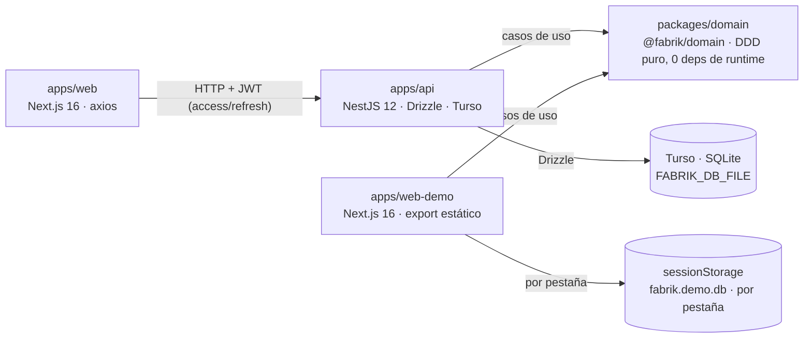

# Arquitectura

Fabrik es un monorepo pnpm + Turborepo con cuatro piezas: un dominio DDD puro compartido
(`@fabrik/domain`), una API HTTP (NestJS) que lo expone sobre SQLite, un panel de
administración (Next.js) que consume la API y una demo autocontenida que ejecuta el mismo
dominio dentro de la pestaña, sin backend. Toda operación productiva pasa por los mismos
casos de uso y deja rastro: movimientos de stock firmados (+/−), eventos por lote y una
genealogía completa — de un lote a sus insumos, y de un suministro a los lotes afectados —
que sostiene los recalls.

Esta página describe la estructura del sistema y sus decisiones estructurales. La
referencia transversal de la API está en [api.md](api.md), la demo en [demo.md](demo.md) y
el registro de deudas conocidas en [limitaciones-conocidas.md](limitaciones-conocidas.md).

## Monorepo y regla de oro

| Paquete | Qué es |
|---|---|
| `packages/domain` (`@fabrik/domain`) | Capa de dominio compartida: entidades, value objects, casos de uso, eventos, puertos y errores. DDD puro, cero dependencias de runtime. |
| `apps/api` | API HTTP NestJS 12: implementa los puertos con Drizzle + Turso y los expone como REST sobre 45 rutas, con OpenAPI en `/docs`. |
| `apps/web` | Panel de administración Next.js 16: consume la API por HTTP con axios, 100 % en español. |
| `apps/web-demo` | Fork de `apps/web` sin backend: ejecuta los casos de uso en el navegador con `sessionStorage`. |

**La regla de oro:** `packages/domain` es puro — cero dependencias de runtime y cero
frameworks. No importa nada de NestJS, Next.js, Drizzle, Turso ni `node:*`; solo depende
de la librería estándar de JavaScript/TypeScript. La dependencia es estrictamente
unidireccional: el dominio no sabe quiénes lo consumen y las apps nunca le inyectan
código propio.



El paquete se consume **compilado**: el `exports` map de su `package.json` apunta a
`dist/index.js` + `dist/index.d.ts` y los imports relativos del fuente llevan extensión
`.js` explícita, de modo que el ESM emitido resuelve en Node. Turbo encadena el orden de
build (`dependsOn: ^build`), así que `pnpm build` en la raíz compila el dominio antes que
sus consumidores; ningún app consume el fuente.

Dentro del paquete, el orden de dependencia también está acotado:

```text
value-objects → errors → events → entities → ports → use-cases
```

Los casos de uso conocen entidades y puertos, nunca al revés; las entidades no conocen
repositorios ni eventos. El contexto de ejecución es un `Actor { workerId, role }` que la
app (API o demo) resuelve de la sesión autenticada y pasa explícitamente a
`useCase.execute(actor, command)`. La autorización vive en la capa de casos de uso
(`requireRole` → `UnauthorizedRoleError`), no en las entidades ni en los controladores.

## Arquitectura hexagonal: puertos, adaptadores y frontera

El dominio define los contratos; cada app los implementa.

**Puertos del dominio** — nueve repositorios y la unidad de trabajo:

| Puerto | Contrato |
|---|---|
| `MaterialRepository` | `findById(id) → T \| null`, `list(filter?)`, `save` (upsert), `existsByName?` (opcional) |
| `LocationRepository` | `findById`, `list(filter?)`, `save` |
| `MachineRepository` | `findById`, `list(filter?)`, `save` |
| `WorkerRepository` | `findById`, `list(filter?)`, `save` |
| `RecipeRepository` | `findById`, `list(filter?)`, `save` |
| `AssignmentRepository` | `findById`, `findByWorker`, `findByMachine`, `save`, `delete` (el único borrado real) |
| `BatchRepository` | `findById`, `list(filter?)`, `save`, `findByMaterial?` (opcional) |
| `BatchEventRepository` | append-only: `add` idempotente, `findById`, `listBy(filters)`, `listByInputBatchId` |
| `StockMovementRepository` | append-only: `add` idempotente, `listByLocation`, `sumByLocationAndMaterial → StockDelta \| null` |
| `UnitOfWork` | `run(fn(repos))`: entrega repos ligados a la transacción; commit si el callback resuelve, rollback si lanza |

Junto a ellos, una interfaz mínima `EventBus` (`publish`) acompaña al catálogo de eventos
de dominio. Los puertos son interfaces TypeScript: en la API se registran por *token*
symbol de DI; los métodos opcionales (`existsByName?`, `findByMaterial?`) son atajos que
los adaptadores pueden omitir.

**Adaptadores por app:**

- La **API** implementa los nueve puertos + `UnitOfWork` con Drizzle ORM sobre el motor
  embebido de Turso (`@tursodatabase/database`): mappers tabla ↔ entidad, esquema derivado
  de las entidades, migraciones SQL versionadas y un `DrizzleUnitOfWork` que abre
  `db.transaction`. `batch_events` y `stock_movements` son tablas append-only: los
  adaptadores solo exponen `add`/lecturas, nunca `UPDATE`/`DELETE` (I4).
- La **demo** implementa el mismo contrato sobre los 9 puertos con snapshots planos en
  `sessionStorage`; su `UnitOfWork` entrega los mismos repos y hace autosave al confirmar
  (sin rollback real — ver [limitaciones-conocidas.md](limitaciones-conocidas.md)).
- Una **conexión única** la administra `PersistenceModule` en la API, cuyo ciclo de vida
  aplica las migraciones al arrancar y cierra la conexión al apagar.

Los **casos de uso son la frontera** de ambas apps: los controladores de la API y los
módulos de la demo no reimplementan reglas — convierten la entrada al dominio, ejecutan el
caso de uso con el `Actor` resuelto y serializan la respuesta. Los eventos se publican
después de persistir (y después del commit en las operaciones transaccionales).

## La API (`apps/api`)

NestJS 12 ESM con zod como única fuente de validación y de tipos (los DTOs derivan el tipo
del schema, imposibilitando que DTO y validación diverjan). Cada recurso vive en
`src/<recurso>/` siguiendo el mismo patrón (`*.controller.ts` + `*.dto.ts` +
`*.module.ts`); los casos de uso se registran como providers con un factory explícito por
clase, y un filtro global de excepciones traduce `DomainError` a HTTP con un cuerpo
estable (tabla completa en [api.md](api.md)).

### Autenticación

La auth vive solo en `apps/api` (se guarda por `workerId`; el `Worker` del dominio no
tiene password). Login por `name` + contraseña sobre JWT manual — sin librerías de auth —
firmado con HMAC-SHA256 desde `node:crypto`, y contraseñas con scrypt autocontenido
(algoritmo, parámetros y sal en un único string), comparado con `timingSafeEqual`; en un
login con nombre inexistente se calcula un scrypt de descarte para no filtrar qué
usuarios existen por timing.

- `POST /auth/login` (público) devuelve un access token corto (~15 min por defecto) y un
  refresh rotativo (~30 días, identificado por `jti`).
- El refresh token se persiste **solo como SHA-256**: la rotación es un compare-and-swap
  sobre `revoked_at` — solo el request que gana la carrera emite el par nuevo — y
  presentar un refresh ya revocado (reuso) revoca **toda la cadena viva del worker** y
  responde 401. `POST /auth/logout` revoca todos los refresh vivos del actor (204).
- El `ActorGuard` es un guard global (`APP_GUARD`) con exención explícita (`@Public()` en
  `/health`, `/auth/login`, `/auth/refresh`): ninguna ruta queda pública por descuido. El
  guard **solo autentica** (401 sin token o con token vencido); en **cada request**
  recarga el worker y usa su **rol actual**: un token viejo no conserva privilegios si
  cambian el rol del worker o se lo da de baja; el claim `role` es informativo. La
  autorización por rol sigue siendo del dominio (`UnauthorizedRoleError` → 403).
- El admin de arranque nace del entorno (`BOOTSTRAP_ADMIN_NAME` /
  `BOOTSTRAP_ADMIN_PASSWORD`): crea el worker + credenciales solo si no existen
  (idempotente, nunca actualiza rol ni password de uno existente).
- El reloj del **servidor** es la fuente de verdad para todas las fechas, incluida la
  vigencia de asignaciones que sustenta I3. `POST /production/transform` descarta el
  `timestamp` del cuerpo salvo que `FABRIK_ALLOW_CLIENT_TIMESTAMP=true` — pensado solo
  para tests e2e, no para producción.

### CORS

La API habilita CORS leyendo `CORS_ORIGINS` (lista separada por comas; default
`http://localhost:3000`, el origen del panel en desarrollo) **sin credenciales**, porque
la autenticación va por `Authorization: Bearer` y no usa cookies. En producción la
variable debe fijarse al origen real del front.

### OpenAPI

El documento OpenAPI se genera desde los **mismos schemas zod** que validan los
controladores (`@asteasolutions/zod-to-openapi` + `@nestjs/swagger`): los cuerpos no se
reescriben, salen de los schemas de cada DTO. Se sirve en `/docs` (UI de Swagger) y
`/docs-json` (JSON). La tabla de rutas es explícita (`OPENAPI_ROUTES`, porque los
controladores no llevan decoradores de Swagger) y un e2e **anti-drift** enumera las rutas
realmente montadas por el adaptador y exige igualdad exacta: añadir un endpoint sin
documentarlo rompe la suite. El esquema de seguridad es `bearerAuth` global, anulado en
las rutas públicas.

### EventBus

El `EventBus` es in-process (`InMemoryEventBus`): el contrato del dominio solo tiene
`publish` y en producción el efecto es no-op (acumula para los tests). Sustituirlo por una
cola real es cambiar un único provider, sin tocar el dominio. Hoy no hay consumidores
acoplados a las publicaciones.

## La web (`apps/web`)

Panel de administración Next.js 16 (App Router, React 19, Tailwind v4 + shadcn/ui),
aplicación 100 % client-rendered y en español (i18n hardcodeado). El motivo del shell de
cliente es que los tokens viven en `sessionStorage` (key `fabrik.session`, ambos tokens),
que no existe en el servidor; así no hay bootstrap de sesión ni estados intermedios de
hidratación, sin beneficio real para una herramienta interna.

- **Acceso a datos por módulo.** Los componentes nunca llaman a axios directamente: cada
  recurso tiene su módulo en `lib/api/modules/*` con su interfaz tipada. La instancia
  compartida (`client.ts`) lleva interceptores — agrega `Authorization: Bearer`, y ante un
  `401` resuelve el refresh en **single-flight** (los `401` concurrentes comparten la
  misma promesa en vez de disparar rotaciones en cascada), reintenta la petición original
  con el token nuevo y, si el refresh falla, limpia la sesión y redirige a `/login`. El
  `401` nunca llega a la UI.
- **Wire DTOs espejo exacto.** `lib/api/types.ts` replica campo a campo lo que emiten los
  serializadores de la API (`quantity`, `slot` como objetos, fechas ISO con `Z`,
  opcionales omitidos) y los ids viajan como **strings opacos**: los branded ids del
  dominio no aportan en runtime. Del dominio se importan las unions literales
  (`UnitOfMeasure`, `MachineStatus`, …) tipo-only y validaciones puras reutilizables
  (`TimeSlot.overlaps` para pre-validar asignaciones en formularios,
  `unitsForPhysicalState` para derivar unidades): nunca repositorios ni conexiones — el
  front habla con la API por HTTP.
- **Data fetching y errores.** El hook `useApiQuery` unifica carga/error/reintentos sobre
  los módulos; los errores se normalizan a `ApiError` y `errorToMessage()` mapea las
  clases de dominio a mensajes en español.
- **RBAC en dos niveles.** La UI filtra la navegación con la misma matriz de roles que la
  API, pero el RBAC real lo aplican los casos de uso del dominio (emerge como 403). Donde
  un rol no puede leer catálogos (el worker), las pantallas degradan a entrada manual de
  ids/unidad con nota visible; la validación completa queda del lado de la API (I6).

## La demo (`apps/web-demo`)

Fork de `apps/web` donde los módulos de datos llaman fábricas demo en lugar de axios:
mismos componentes, mismos wire DTOs y mismos mensajes de error, pero el transporte es
código de la pestaña (módulos → casos de uso → repos sobre `sessionStorage`). La base y
una historia productiva completa se siembran en el primer click; cada pestaña es un mundo
aparte. El detalle (credenciales, schema, reset, despliegue en Pages) está en
[demo.md](demo.md).

## Operación

- **CI**: `.github/workflows/ci.yml` corre en cada push y PR a `main` — lint (Biome),
  check de formato, typecheck del dominio, build del monorepo y las suites de test de los
  cuatro paquetes.
- **Despliegue de la demo**: `deploy-demo.yml` publica el export estático a GitHub Pages
  a `https://beresiartejuan.github.io/fabrik-js/` cuando cambian archivos de
  `apps/web-demo/`. Detalles en [demo.md](demo.md).