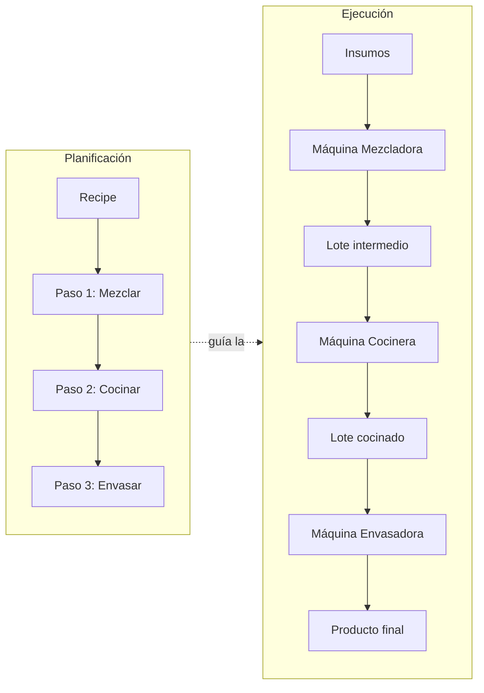

# Flujo de Producción

La producción de Fabrik combina un modelo **declarativo** — qué se planea
hacer: la `Recipe` — con un modelo de **ejecución** — qué pasó realmente: los
`Batch` y `BatchEvent` que la producción registra.

## Visión general



## El ciclo completo

1. **Arribo de suministros** — llegan materias primas. `RegisterSupplyArrival`
   crea el lote de suministro — que nace directamente en el almacén, estado
   `stored` — y el movimiento de entrada (`supply_in`) en el lugar de
   almacenamiento. Anuncia `supply.arrived`.
2. **Planificación** — el admin define o edita una receta con pasos ordenados.
   Ejemplo: «Jabón líquido» = Mezclar (tipo `mixer`) → Cocinar (tipo `cooker`)
   → Envasar (tipo `filler`).
3. **Inicio de la orden** — `StartProduction` crea el **lote raíz** de la receta
   en `in_progress` y anuncia `batch.created`. El lote raíz es la orden: su
   cantidad es la planificada; la real aparecerá en los lotes que produzcan las
   transformaciones.
4. **Ejecución paso a paso** — un operario asignado a la máquina del paso
   registra la transformación (`RecordTransformation`): consume los lotes de
   input (descuenta stock), crea los lotes de output y escribe el `BatchEvent`
   con máquina, operario, inputs, outputs y observación opcional. Anuncia
   `batch.transformed`. El detalle de esta operación está en
   [`modelo-de-dominio.md`](modelo-de-dominio.md).
5. **Almacenamiento** — `StoreBatch` pasa un lote a un lugar de almacenamiento:
   el lote queda `stored` y el output ingresa al stock con motivo `produced`
   vinculado al evento que lo originó. Anuncia `batch.stored`. Entre pasos, el
   lote puede esperar almacenado la siguiente máquina.
6. **Cierre de la orden** — `CompleteProduction` marca el lote raíz como
   `completed` y anuncia `production.completed`. Solo las órdenes — lotes con
   receta — se pueden completar. El catálogo completo de eventos está en
   [`eventos.md`](eventos.md).

## Trazabilidad y auditoría

`TraceBatch` reconstruye la **genealogía hacia atrás**: siguiendo el
`originBatchEventId` de cada lote se obtiene el árbol completo desde los
suministros hasta el producto final.

```mermaid
flowchart BT
    S1[Batch aceite] --> E1[BatchEvent: Mezcla<br/>máquina M1, operario Juan<br/>obs: "mezcla espesa"]
    S2[Batch sosa] --> E1
    E1 --> I1[Batch mezcla cruda]
    I1 --> E2[BatchEvent: Cocinado<br/>máquina M2, operaria Ana]
    E2 --> F[Batch jabón final]
```

Con ese árbol un **auditor** puede responder:

- ¿Qué suministros exactos forman este producto?
- ¿Qué máquinas y qué trabajadores intervinieron, en qué horario?
- ¿Hubo observaciones anómalas en algún paso?
- ¿Qué otros productos comparten un lote de suministro sospechoso? La
  genealogía hacia adelante (`TraceForward`) recorre el camino inverso con sus
  eventos y productos: la base de un *recall*.

## Reglas de ejecución

- El operario solo puede registrar transformaciones en máquinas a las que está
  asignado en el horario actual, evaluado por la API (invariante I3).
- Las cantidades reales de output pueden diferir de lo planificado (mermas): se
  registra la realidad, y la discrepancia queda visible al auditar.
- Los `BatchEvent` son inmutables: corregir un error es registrar un evento
  compensatorio, nunca editar el original.

## El ciclo, tal como lo ejecuta el producto

El ciclo descrito aquí no es teoría: la demo lo ejecuta íntegro con los casos
de uso reales del dominio. El seed inicial define el catálogo, las máquinas y
la receta «Pan artesanal» (espejo del seed de la API, con identificadores
legibles), y el histórico se siembra ejecutando el flujo completo — arribos por
el admin, orden iniciada, transformaciones y almacenados por el operario, cierre
por el admin — dejando lotes, eventos y stock listos para auditar en cuanto se
entra:

- Seed base de la demo: [`apps/web-demo/src/lib/api/demo/seed.ts`](../apps/web-demo/src/lib/api/demo/seed.ts)
- Histórico productivo (arribo → orden → transformar → almacenar → completar):
  [`apps/web-demo/src/lib/api/demo/history.ts`](../apps/web-demo/src/lib/api/demo/history.ts)
- Seed equivalente del backend: [`apps/api/src/persistence/seed.ts`](../apps/api/src/persistence/seed.ts)