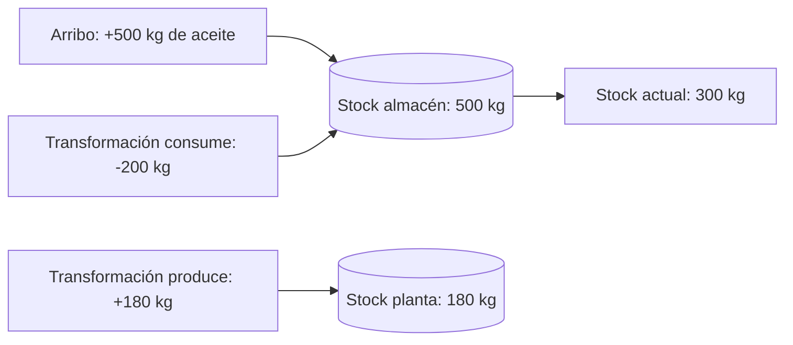

# Inventario

## Principio

**El stock no es un campo: es un agregado de movimientos.**

No existe un saldo editable. El stock actual de un material en un lugar es la
suma de sus `StockMovement`: cada `delta` firmado suma en las entradas y resta
en las salidas. Esto da trazabilidad nativa del inventario: cada unidad
presente en un lugar puede explicarse por los movimientos que la trajeron, y
cada movimiento por su motivo — y, si nació de producción, por el evento que la
originó.

## El movimiento de stock

Cada `StockMovement` declara el lugar, el material, la variación firmada
(`StockDelta`, nunca cero), el motivo e instante. Es inmutable: enmendarlo
nunca ocurre; se registra un movimiento compensatorio.

| Motivo | Cuándo ocurre | Vínculo a producción |
|---|---|---|
| `produced` | Un output de una transformación ingresa a almacenamiento (`StoreBatch`) | Exigido: apunta al `BatchEvent` |
| `consumed` | El input de una transformación se descuenta del lugar de la máquina | Exigido: apunta al `BatchEvent` |
| `supply_in` | Arribo externo de suministros (`RegisterSupplyArrival`) | No lleva |
| `transfer_in` | Ingreso de un lote sin origen de producción, vía `StoreBatch` | No lleva |
| `transfer_out` | Declarado en el modelo, no se emite hoy | — |
| `manual_adjustment` | Corrección de conteo físico | No lleva |

El motivo es disciplinado: los movimientos ligados a producción **exigen** el
vínculo al evento que los originó; el resto **no admite** ese vínculo. Así,
desde cualquier movimiento de producción se llega al `BatchEvent`, al operario,
a la máquina y a los lotes.

## Saldos y consultas

- **Stock actual por lugar**: suma de movimientos agrupada por material,
  expuesta por `GetStockByLocation` y consumible por los tres roles.
- **Historial de movimientos**: `GetStockMovements` lista los movimientos de un
  lugar — filtrables por material — para admin y auditor.
- **Stock global de un material**: es la suma a través de los lugares; como se
  explica abajo, hoy no es un indicador confiable.

Los saldos de **plantas** (lugares de producción) pueden quedar negativos: los
consumos se descuentan en el lugar de la máquina, y la regla que impediría
bajar de cero está diferida
([limitaciones-conocidas.md#i5-stock-negativo-en-plantas](limitaciones-conocidas.md#i5-stock-negativo-en-plantas)).
Por la misma razón, las transferencias entre lugares no existen hoy como
operación ([limitaciones-conocidas.md#transfer_out-no-implementado](limitaciones-conocidas.md#transfer_out-no-implementado)).

## Fuera de alcance del modelo

Decisiones tomadas y vigentes: sin capacidad máxima por lugar, sin reservas de
stock y sin valoración monetaria. El inventario describe **qué hay y de dónde
vino**, no cuánto vale ni cuánto cabe.

## Lecturas complementarias

- [`modelo-de-dominio.md`](modelo-de-dominio.md) — el movimiento como entidad y
  su papel en las invariantes.
- [`eventos.md`](eventos.md) — el evento de inventario que este módulo declara
  y su estado de emisión.
- [Referencia de casos de uso](../packages/domain/docs/referencia/casos-de-uso.md) —
  las consultas de stock con sus roles y errores.