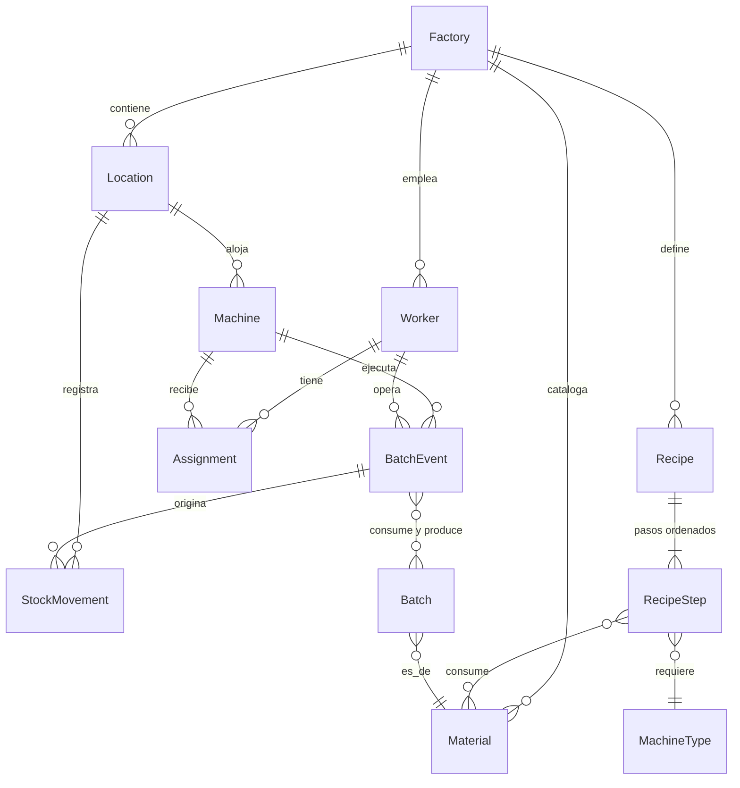

# Modelo de Dominio

El dominio vive en `packages/domain` como un paquete independiente sin
dependencias de runtime: entidades, value objects, casos de uso y eventos. Las
identidades son value objects opacos (`WorkerId`, `MachineId`, …) y las
entidades son inmutables: toda modificación produce una instancia nueva
(*copy-on-write*). Este documento describe el modelo como producto; el detalle
de implementación — campos, factories y métodos de cada clase — está en la
[referencia de entidades](../packages/domain/docs/referencia/entidades.md) y de
[value objects](../packages/domain/docs/referencia/value-objects.md).

## Factory

Raíz del contexto: agrupa lugares, máquinas, trabajadores y catálogos. No tiene
comportamiento propio; delimita el universo de la fábrica.

## Material

Catálogo de los ítems físicos que maneja la fábrica. Suministros y productos
comparten estructura y se distinguen por su naturaleza (`supply` / `product`).
Cada material declara un estado físico — sólido, líquido o gaseoso — y una
única unidad de medida coherente con él, que gobierna todas sus cantidades.
La baja es lógica (`active`): los materiales históricos nunca desaparecen,
porque la trazabilidad los necesita vivos.

## Worker

Trabajador con nombre, rol (`admin`, `worker`, `auditor`) e indicador de
actividad. El rol es un dato de identidad; la autorización ocurre en los casos
de uso, nunca dentro de las entidades. La gestión de trabajadores es auto-
protegida: un admin no puede cambiar su propio rol ni desactivarse.

## Location

Lugar de la fábrica, de dos clases: `production` (aloja máquinas) o `storage`
(almacena stock). La clase no es decorativa: las máquinas solo pueden vivir en
lugares de producción y el stock solo se registra en lugares de almacenamiento.

## Machine

Máquina con un tipo abierto (`MachineType`, por ejemplo `mixer` o `cooker`) que
habilita los pasos de receta que puede ejecutar, y un estado operativo con el
ciclo `idle ⇄ running` y la derivada `idle → maintenance → idle`. Una máquina
en mantenimiento no registra transformaciones.

## Recipe y RecipeStep

La receta es el modelo **declarativo** de la producción: una cadena ordenada de
pasos, cada uno con el tipo de máquina que lo ejecuta, los materiales y
cantidades que consume y el producto intermedio que produce. El output del
último paso debe coincidir con el output declarado de la receta.

Actualizar la receta **reemplaza la lista completa de pasos**: no es una
fusión por posición. Las recetas ya usadas por una orden no se destruyen; la
producción registrada referencia la receta que se ejecutó.

## Batch

El lote es la instancia física trazable de un material. Su ciclo de vida es
acotado:

```
in_progress ⇄ stored        (store / resume)
in_progress | stored → completed   (estado final)
```

Tres orígenes posibles: un arribo de suministro (nace ya `stored`, sin receta),
el inicio de una orden (lote raíz `in_progress`, con receta) o el output de una
transformación (nace `in_progress` vinculado al evento que lo produjo). El lote
raíz — la orden — lleva una cantidad **planificada**; las cantidades reales se
registran en los lotes de output de cada transformación, que es como las mermas
quedan visibles al auditar.

## BatchEvent

Registro inmutable de una transformación ejecutada: máquina, operario, lugar,
paso de receta ejecutado (si corresponde), lotes consumidos con sus cantidades,
materiales producidos con sus cantidades, observación opcional del operario y
el instante del servidor. Nunca se edita ni se borra: corregir un error es
registrar un evento compensatorio. Es la pieza que conecta planificación,
ejecución, inventario y auditoría.

## Assignment

Asignación horaria de un trabajador a una máquina, en una franja semanal
(`TimeSlot`). La relación trabajador-máquina es varios a varios, con la
restricción de que un trabajador no puede tener franjas solapadas.

## StockMovement

Movimiento de stock inmutable en un lugar de almacenamiento: material, variación
firmada, motivo e instante. El stock actual es la **suma** de los movimientos,
no un campo editable. Su detalle y motivos se documentan en
[`inventario.md`](inventario.md).

## Value Objects clave

- **`Quantity`** — monto mayor que cero con una unidad de medida. Se suma y
  resta solo entre cantidades de la misma unidad; no hay conversión entre
  unidades. La coherencia unidad ↔ estado físico se valida contra el material.
- **`TimeSlot`** — franja semanal `[start, end)` semiabierta: incluye el inicio
  y excluye el fin. `end` admite `24:00` para cubrir la jornada completa; no
  hay franjas que crucen medianoche. Evalúa solapamiento (base del invariante
  de agenda) y contención de instantes, ambos en la **zona horaria local del
  servidor**, que es la fuente de verdad: los clientes no recalculan la
  vigencia, consumen la evaluación hecha por la API.
- **`StockDelta`** — variación firmada de stock. Es distinta de `Quantity` a
  propósito: una salida necesita ser negativa, y `Quantity` exige montos
  positivos.

## Unidades válidas según estado físico

La unidad de un material se elige entre las coherentes con su estado físico
(`unit` son unidades discretas — piezas — y solo aplican a sólidos):

| Estado físico | Unidades válidas |
|---|---|
| `solid` | `g`, `kg`, `unit` |
| `liquid` | `ml`, `l` |
| `gas` | `ml`, `l`, `m3` |

## Relaciones



## El registro de transformaciones

`RecordTransformation` es la operación núcleo del piso de planta: convierte el
plan en historia. El comando declara la máquina, al menos un input o un output,
y opcionalmente el paso de receta ejecutado y una observación.

**Validaciones, en orden de ejecución:**

1. El actor tiene rol `worker`, y el operario del comando es el propio actor:
   cada operario solo firma sus transformaciones.
2. El comando describe una transformación real (algún input o output) y no
   repete lotes entre sus inputs.
3. El operario existe y está activo; la máquina existe y no está en
   mantenimiento.
4. Vigencia horaria: el operario tiene asignación a **esa** máquina cuya franja
   contiene el instante del evento.
5. Si se declara un paso de receta y alguno de los lotes consumidos aporta
   contexto de receta, el paso debe existir en esa receta y la máquina debe ser
   del tipo que el paso exige. En transformaciones *ad-hoc* — sin contexto de
   receta — esta validación se omite
   ([limitaciones-conocidas.md#transformación-ad-hoc-sin-validación-de-paso](limitaciones-conocidas.md#transformación-ad-hoc-sin-validación-de-paso)).
6. Cada material de output existe y su cantidad usa la unidad del material.

**Efectos, en una sola unidad de trabajo:** se crea el `BatchEvent` inmutable
(en el lugar de la máquina, con el `workerId` del actor y el **instante del
servidor** — el reloj del cliente no participa); se registran los movimientos
de stock `consumed` de cada input en el lugar de la máquina; se crean los
lotes de output `in_progress`, cada uno vinculado al evento que lo originó.
Solo después del commit se publica el evento de dominio `batch.transformed`.

La suficiencia de stock de los consumos no se valida en esta operación; la
razón y sus consecuencias están explicadas en
[`inventario.md`](inventario.md).

## Invariantes

| # | Invariante | Estado actual |
|---|---|---|
| **I1** | Un operario no puede tener dos asignaciones cuyas franjas se solapen, sea cual sea la máquina | Vigente: se valida al asignar (`OverlappingScheduleError`) |
| **I2** | Una máquina solo puede ubicarse en un lugar de producción | Vigente: en alta y traslados de máquina |
| **I3** | Un `BatchEvent` solo lo registra un operario con asignación vigente a esa máquina en ese horario | Vigente: se evalúa con el instante del servidor (`WorkerNotAssignedError`) |
| **I4** | `BatchEvent` y `StockMovement` son inmutables | Vigente: por construcción de las entidades |
| **I5** | Una salida no puede dejar el stock por debajo de cero | **Diferido**: los saldos de planta pueden quedar negativos hoy ([limitaciones-conocidas.md#i5-stock-negativo-en-plantas](limitaciones-conocidas.md#i5-stock-negativo-en-plantas)) |
| **I6** | Las cantidades de transformaciones y movimientos usan la unidad del material | Vigente: en catálogos, arribos y outputs de transformación |
| **I7** | El output de la receta coincide con el de su último paso | Vigente: en la entidad receta (`RecipeIntegrityError`) |

Dónde se aplica cada invariante en el código, con qué error y por qué:
[invariantes, explicación del dominio](../packages/domain/docs/explicacion/invariantes.md).

## Lecturas complementarias

- [Casos de uso, referencia del dominio](../packages/domain/docs/referencia/casos-de-uso.md) —
  cada operación con sus roles, dependencias y errores.
- [Flujo de producción](flujo-de-produccion.md) — cómo se combinan estas piezas
  en el ciclo completo.
- [Eventos](eventos.md) — qué anuncian estas operaciones al resto del sistema.